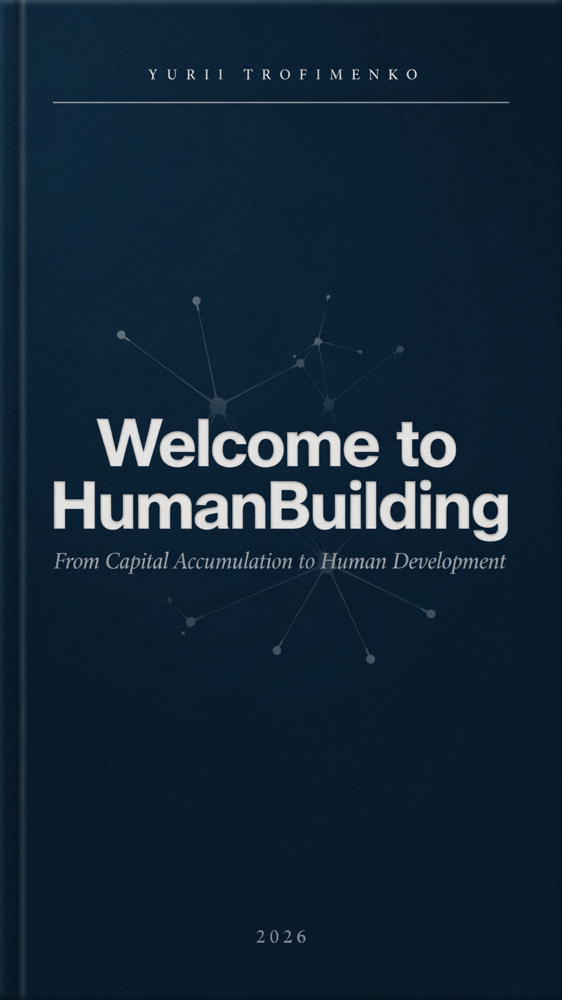

Yurii Trofimenko

Welcome to HumanBuilding

From Capital Accumulation to Human Development

We have worshipped the arrow and forgotten the recoil.

We have counted the trophies and ignored the transformation of the archer.

2026

Abstract

For thousands of years, humanity has measured its progress by the external product — the things we make, the money we accumulate, the empires we build. We have worshipped the arrow and forgotten the recoil.

This book reveals the forgotten half of the equation: the development of the person in the very act of creating everything else. It traces how this inner wealth was systematically stolen by every ruling class in history, diagnoses the three converging crises of late capitalism, examines the precedents of past attempts to build a better world, and offers a practical Starter Kit for the modern HB-progressor.

The end of prehistory does not begin with a global cataclysm. It begins on a Tuesday evening, in a living room, a garage, or a digital chat, when a small group of people decide to stop measuring their lives in dollars and start measuring them in growth.

**Scan to connect with the global HB-progressors community**

*This work is adapted and shared to foster the free development of humanity. Feel free to share, translate, and build upon these ideas. The accompanying software prototypes are open-source.*

TABLE OF CONTENTS

SECTION 1: A MANIFESTO ..................................................................................................... 6

Prologue: The Forgotten Half of the Equation

Part I: What Is HumanBuilding?

Part II: The Hidden Revolution Already Underway

Part III: What You Can Do — Starting Today

Part IV: The Call

Part V: To Be Continued

SECTION 2: THE THEFT OF OUR INNER WEALTH ........................................................... 13

Prologue: The Crime Scene

Chapter 1: The Original Abundance

Chapter 2: The First Theft — "Culture" with a Capital C

Chapter 3: The Long Night — When God Took the Inner World

Chapter 4: The Bourgeois Revolution and Its Betrayal

Chapter 5: The Final Betrayal — Pop-Culture and the Fragmented Self

Chapter 6: The Hidden Rebellion

Epilogue: The Thief's Greatest Fear

SECTION 3: THE DIAGNOSIS. THREE FACES OF THE SAME DISEASE .......................... 22

Prologue: The Three Horsemen

Chapter 1: The First Horseman — A Planet with Limits

Chapter 2: The Second Horseman — War as a Business Model

Chapter 3: The Third Horseman — The Quiet Death of the Mind

Epilogue: Three Faces, One Disease

SECTION 4: THE PRECEDENTS ........................................................................................... 29

Prologue: The Graveyard of Good Intentions

Chapter 1: Auroville — The City That Was Supposed to Become Humanity

Chapter 2: Twin Oaks — The Commune That Refused to Die

Chapter 3: The Graveyard — New Harmony, Brook Farm, New Odessa

Chapter 4: The USSR — The Largest Attempt in History

Chapter 5: FaSinPat — The Factory Without Bosses

Chapter 6: The Pattern — What the Precedents Teach Us

Epilogue: The Seeds Are Already Here

SECTION 5: THE TOOLS ........................................................................................................ 41

Prologue: The Architecture of the New World

Chapter 1: Mapping the Inner Universe (MySkillsOrganizer & Emberly)

Chapter 2: The Economy of Development (CTFinder)

Chapter 3: Finding Your Tribe (ComradFinder & HistMathica)

Chapter 4: The Living Archive (Common Books & The Autobiography Platform)

Chapter 5: Rooting the Revolution (The Public Garden)

Epilogue: Open Source Humanity

SECTION 6: THE SYNTHESIS ............................................................................................... 45

Prologue: The Convergence

Part I: The Anatomy of a pre-HB Initiative

Part II: The Starter Kit for the Modern HB-Progressor

Part III: Overcoming the Inevitable Friction

Epilogue: The End of Prehistory

APPENDICES & REFERENCES .............................................................................................. 49

# **Section 1: A Manifesto**

## **PROLOGUE: The Forgotten Half of the Equation**

Every action has a reaction. Every shot has a recoil. Every rocket is propelled forward by the exhaust it leaves behind.

For thousands of years, humanity has measured its progress by the **external product** — the things we make, the money we accumulate, the empires we build, the technologies we deploy. We have worshipped the arrow and forgotten the recoil. We have counted the trophies and ignored the transformation of the archer.

But what if the real wealth of humanity was never the gold in the vault, the smartphone in your pocket, or the GDP of your nation? What if the true wealth — the only wealth that cannot be stolen, taxed, or destroyed — is **the development of you, the person, in the very act of creating everything else**?

This is the central insight of *HumanBuilding* (HB). And it changes everything.

When a blacksmith strikes iron, he shapes the metal — but the iron also shapes him. His skill grows. His patience deepens. His understanding of fire, force, and form becomes part of who he is. When a programmer writes code, she builds software — but she also builds herself. Her mind sharpens. Her capacity for abstract thought expands. When a gardener tends her plot, she grows vegetables — but she also grows her connection to seasons, to soil, to life itself.

This is not poetry. This is the **fundamental law of human existence**. And it has been hidden in plain sight — in your daily life, in every skill you've ever learned, in every conversation that changed you, in every problem you've solved — all along.

The time has come to name it. To claim it. To make it the central purpose of our civilization.

## **PART I: What Is HumanBuilding?**

### **The Concept in One Paragraph**

**HumanBuilding (HB)** is the purposeful transformation of the objective world by individuals — and through them, by humanity as a whole — in the process of which they acquire and develop their own abilities, comprehending the infinite through the finite.

**HB-wealth** is the integral totality of all humanity, knowledge, skills, competencies, and "inner worlds" acquired in the process of HB. Unlike material wealth, it cannot be transferred mechanically, sold, stolen, or taken away. It is yours. It is us. It is the only true wealth of the human species.

### **The Formula of Self-Growth**

Just as capital moves in a cycle — Money → Commodities → More Money (M–C–M') — HB-wealth moves in its own cycle:

**HBV → Practice → HBV'**

You begin with a certain stock of knowledge and skill (HBV). You encounter a task that exceeds your current capacity — a **cultural lack**. You engage in practice (P). You emerge with expanded capability (HBV'). This is the rhythm of every human life at its best. And under capitalism, this rhythm has been hijacked, distorted, and nearly silenced.

### **The Historical Theft**

For most of history, the ruling classes understood something the rest of us did not: **the real prize was not the grain in the silo, but the development of the people who grew it**. They monopolized this development. They called it "Culture" with a capital C — philosophy, art, science, statecraft — and reserved it for themselves. The rest of humanity was left with "culture" in lowercase — the habits, tastes, and survival routines of everyday life.

Then came capitalism, and something strange happened. The old division began to dissolve — but not into freedom. It dissolved into a **homogeneous mixture**: pop-culture, consumerism, the fragmentation of personality into isolated modules, each tuned to consume a specific product. We were "liberated" from the old Culture only to be enslaved by a new kind of anti-culture — one that produces not subjects, but **consumers**.

The result? A species that has conquered the atom, mapped the genome, and built a global network — but has forgotten how to grow itself.

## **PART II: The Hidden Revolution Already Underway**

Here is the good news — and it is genuinely good.

Across the planet, **without coordination, without a manifesto, without even a shared vocabulary**, people are already living the HB revolution. They just don't know it yet. They are the sparks of the future, flickering in the cracks of the present.

Let me introduce you to some of them.

### **Danny Forest — The Polymath of the Digital Age**

Danny is a software engineer, writer, photographer, and entrepreneur. But that's not what makes him remarkable. What makes him remarkable is that **he has been learning three new skills every month for three years running**. His personal website displays not a bank balance, but a sprawling, branching tree of his HB-wealth: languages spoken, places lived, organizations served, skills mastered.

He founded SkillUp Academy — a free, open database of skills, their interconnections, and learning resources. He doesn't do this for money. He does it because **the act of learning, and helping others learn, is its own reward**. It is, in Lenin's phrase, "the first vital need of a healthy organism."

### **Roman Vydro — The Garage That Became a Movement**

In Kharkiv, a group of students started a "budget Fablab" in a garage. They called it Garage Hub. Today it occupies a spacious facility with CNC machines, laser cutters, and 3D printers. But the equipment is not the point.

"We are an irritant," Roman told me. "We make people ask themselves: *Maybe I need something more? Maybe I need my own garage where I can draw, sculpt clay, or — damn it — write poetry?*"

This is HB-activism in its purest form: **creating the conditions for others to discover their own capacity for growth**.

### **Alexander Bebris — The Teacher Who Refuses to Charge**

Alexander runs a network of YouTube channels that teach foreign languages — from zero to full fluency — completely free. No donations. No sponsors. No premium tiers (well, one optional premium tier, priced so low that anyone can afford it).

"I want to do everything for free," he says. "I want to fundamentally change the idea that today you need to care only about yourself. There are people for whom earning is easy, they are always provided for. And there are those for whom it comes with great difficulty. I don't want to tear their crumbs away from them. My principle is to do as much good as possible."

Alexander is not a capitalist. He is not a charity case. He is something the present system has no category for: **a person who has aligned his material survival with the free development of others**.

### **Vladimir Stepchenkov and Evgenia Volkova — The Intergenerational Collective**

In Zelenograd, Vladimir and Evgenia run two creative collectives: Mega-Club (archaeological expeditions) and Oberton (music, poetry, acting). The remarkable thing is not what they do — it is **who does it with them**. Children and teenagers participate as full equals, not as students being instructed, but as co-creators.

This is the HB principle in action across generations: **the young learn by doing, the old renew themselves by teaching, and the collective grows in ways no individual could predict**.

### **What They All Have in Common**

Look closely at these people. They come from different countries, different backgrounds, different traditions. Some are secular, some religious. Some are engineers, some artists, some teachers. But they share a **structural feature**:

1.  **They pursue multi-directional self-development** — not as a means to a career, but as an end in itself.

2.  **They actively facilitate the same development in others** — not as charity, but as a natural extension of their own practice.

3.  **They erase the boundary between "work time" and "leisure time"** — because for them, HB *is* life.

I call such people **pra-HB people** (proto-HB people), and their way of life **pra-HB culture**. They are not yet conscious of their historical role. They do not yet see themselves as part of a movement. They are simply living as fully human beings in a system that makes this nearly impossible.

**Our task is to help them see themselves. To help them see each other. To help them connect.**

## **PART III: What You Can Do — Starting Today**

This is not a book about abstract theory. It is a book about **what to do next**. The time for contemplation is over. The stakes are existential — ecological collapse, nuclear threat, the quiet extinction of the human psyche into virtual reality. We have years, perhaps decades, not centuries.

But here is the crucial point: **you do not need to wait for the revolution. You can begin the revolution now, in the space of your own life, with the tools already at hand.**

### **The Seven Practical Pathways**

Based on the analysis of successful pre-HB initiatives around the world, I have identified seven concrete directions for HB-progressivism that are accessible to almost anyone, right now, under late capitalism.

#### **1. Rebirth Your Workplace**

You don't need to quit your job to start the revolution. You need to **change the primary metric of success** in your workplace.

Instead of net profit, measure **the development of each employee**. Instead of KPIs for output, track KPIs for skill acquisition, cross-training, creative initiative, and mutual support.

This sounds utopian. It is not. It is already happening in pockets: in the testing center in Mariupol (before its destruction in 2022), where department heads gave lectures to each other's teams to build universality; in the Mondragon Corporation in the Basque Country; in the worker-run FaSinPat tile factory in Argentina.

**Your action step:** Identify one aspect of your workplace where development is stifled. Propose a pilot project that replaces it with a development-oriented alternative. Start small. Measure human growth, not just the output.

#### **2. Build or Join an HB-Oriented Fablab**

Fablabs — digital fabrication workshops with CNC machines, laser cutters, 3D printers — are spreading worldwide. Most are commercial. Some are attached to universities. A few, like Garage Hub, are something new: **spaces where the primary product is not the prototype, but the person who builds it**.

**Your action step:** If your city has a Fablab, go there. Not to make things — to meet the people who make things. Propose a "skill-swap" evening where everyone teaches one skill and learns another. If your city doesn't have a Fablab, start a discussion group. The equipment can come later. Human connections must come first.

#### **3. Launch a Humanities Self-Education Circle**

The heart of the coming new society will be a **living, developing dialectical-materialist worldview** — not as dogma, but as a tool for understanding and transforming reality.

Online circles like the Engels network (vk.com/derengels) are experimenting with collective study of philosophy, history, and political economy. The goal is not academic mastery — it is **the formation of a central point in each participant's personality**, from which all other development radiates.

**Your action step:** Gather three to seven people who are tired of the fragmentation of modern life. Meet weekly (in person or online). Read one primary source together. Discuss it not as scholars, but as people trying to understand their own lives. The goal is not to finish the book — it is to finish with a different understanding of yourselves.

#### **4. Create a "Creative Tasks Finder" for Your Community**

The current job market is designed to extract labor, not to develop people. We need a parallel system — a platform where people post **developmental tasks** (not just jobs), and others sign up not for money, but for the growth the task offers.

I built a prototype of such a platform, called CTFinder (Creative Tasks Finder). It is open-source and available on GitHub. A student used it to find a real-world task for his diploma project. An organization got useful work done. Both grew.

**Your action step:** You don't need to build a platform. Start a Telegram channel, a Discord server, or a simple bulletin board in your community. Post one developmental task per week. Invite others to post theirs. The technology is secondary. The practice is primary.

#### **5. Visualize Your Own HB-Wealth**

You have a bank account. You have a CV. You have a LinkedIn profile. But do you have a **map of your own human development**?

Tools like Emberly (created by Gina Husebø and Leif Andreas Rudlang) and my own MySkillsOrganizer prototype allow you to build a visual tree of your skills, knowledge, experiences, and aspirations. This is not self-help. This is **the cartography of your own humanity**.

**Your action step:** Spend one hour this week mapping your own HB-wealth. Not your job titles — your actual capabilities, your curiosities, the problems you've solved, the people you've helped. Share the map with someone you trust. Watch what happens.

#### **6. Start a Public Garden**

In 2018, I proposed a simple idea to a VKontakte group: let's reclaim the abandoned orchards near Mariupol. Plant new trees. Tend the old ones. Eat the fruit — whether you planted it or not. No sales. No ownership. Just **the joy of growing things together**.

The project never launched — life intervened. But the idea is universal. Abandoned gardens exist in every city. Vacant lots. Forgotten parks. These are not blights — they are **dormant HB-factories**, waiting for someone to wake them up.

**Your action step:** Find one abandoned green space in your neighborhood. Talk to your neighbors. Ask permission from the city. Plant something. The specific plan matters less than the act of beginning.

#### **7. Write Your Autobiography — and Share It**

The most valuable data for the coming science of human development is **the detailed record of how each person became who they are** — especially the early childhood years, when the foundations of personality are laid.

I designed a prototype web application for collecting and analyzing autobiographies (see Appendix D). It was never built. But you don't need an app. You need a document.

**Your action step:** Write 5,000 words about the formative experiences of your first ten years. Not the highlights — the *texture*. The smells, the fears, the small moments of discovery. Share it with someone. Ask them to do the same. You are not writing a memoir. You are **contributing to the first dataset of the science of human becoming**.

## **PART IV: The Call**

You are reading this because something in you already knows.

You know that the endless pursuit of money is a trap. You know that the fragmentation of your attention across a dozen apps is not living. You know that the "self-improvement" industry sells you back your own alienation in a prettier package. You know that there is something more — something you have glimpsed in a conversation that went too late into the night, in a project that made you forget to eat, in a moment of genuine connection with another person.

That something has a name. It is **HB**. And it is not a utopia. It is not a dream. It is **the hidden structure of your own life**, waiting to be recognized, claimed, and shared.

The time for waiting is over. The ecological clock is ticking. The military-industrial complex is consuming the future to pay for the present. The virtual reality headset is being fitted over the eyes of the next generation.

But there is another path. It is not a path of violent revolution — that path has been tried, and it always reproduces the old system in new clothing. It is not a path of withdrawal — that path has been tried, and it always ends in irrelevance or co-optation.

It is a path of **peaceful, symbiotic, accelerating construction** — building the new society in the cracks of the old, not to escape it, but to outgrow it. To make the old system obsolete by rendering it unnecessary.

This is the path of HB-progressivism. And it is open to you. Right now. With the skills you already have. In the city where you already live. Among the people you already know.

**The only question is: will you begin?**

## **PART V: To Be Continued**

You now hold the first piece of the map.

You know what HB is. You have met some of the people who are already living it — often without knowing they are doing something historic. You have seven concrete paths you can start walking *today*, before you finish your coffee.

But a question still hangs in the air, doesn't it?

**If HB is the very basis of what makes us human — if it has been with us since the first stone was knapped into a tool — why does almost nobody live by it consciously? Why does the richest, most technologically advanced civilization in history produce so much *stuff* and so little *growth in the people who make it*?**

The answer is not that HB is new. The answer is that HB is *old* — as old as humanity itself. And the reason it is suppressed today is that it has been *systematically stolen* from us, epoch after epoch, by every ruling class that has ever existed.

This is not a metaphor. This is a crime scene. And crime has been going on for at least five thousand years.

In the next section — **The Theft of Our Inner Wealth** — we will walk through that crime scene together. We will trace the long arc from the first tribal fires, where every hunter was a philosopher and every mother a scientist, to the glittering cages of today's virtualized capitalism, where we are trained from childhood to fragment ourselves into a dozen consumer-profiles and call it "freedom."

We will meet the thieves. We will examine their tools — myth, religion, the division of labor, the factory, the screen, the algorithm. We will see how each new ruling class, having seized the *outer* product of human activity, also seized the *inner* product — the development of the producer — and hid it behind a veil of "Culture," "Spirituality," "Personal Branding," or "Lifestyle."

And we will discover something astonishing: **at every stage of history, the ruling class has been terrified of exactly the thing we are trying to revive.** Free, universal, self-directed human development has always been the one threat that could not be co-opted, could not be commodified, could not be turned back into a tool of exploitation. That is why it has always been suppressed.

And that is why, in the end, it will win.

But first, we must understand how we got here.

# **Section 2: The Theft of Our Inner Wealth**

## **PROLOGUE: The Crime Scene**

Every crime has a pattern.

First, the victim possesses something of immense value — something they may not even fully recognize as valuable. Then, someone more powerful notices this value. They do not take it openly; that would provoke resistance. Instead, they build a system — legal, religious, economic, cultural — that *appears* to protect the victim while quietly redirecting the value elsewhere.

Over generations, the victim forgets they ever owned the thing at all. They come to believe it was never theirs to begin with. They thank the thief for the crumbs that fall from the table.

This is the story of humanity.

And this section is the investigation.

## **CHAPTER 1: The Original Abundance**

Let us begin at the beginning — not with a myth, but with what we know.

Somewhere between two and three million years ago, a group of primates in East Africa found themselves losing the biological race. They were not the strongest. They were not the fastest. Their teeth were mediocre. They had no venom, no armor, no wings. By every standard of natural selection, they should have disappeared.

And they *would* have disappeared — had they tried to compete on the terms set by the rest of the animal kingdom.

Instead, they did something no other species had ever done: **they began making tools, and using those tools together.**

A sharp stone. A digging stick. A fire kept alive from day to day. None of these things was impressive on its own. But each one was *made by many hands, used by many hands, passed from hand to hand, from parent to child, from generation to generation.* And in the process of making and using them, something unprecedented happened: **the people who made and used them were themselves being made.**

A child who learned to knap a stone was not just learning a skill. She was developing patience, foresight, an understanding of fracture mechanics, a sense of cause and effect, a capacity to see the *general* in particular — the concept of "sharp," of "edge," of "tool as such." A hunter who tracked an animal across the savanna was not just getting meat. He was developing observation, deduction, empathy (what is animal thinking?), cooperation, and language.

**Every act of transforming the world was simultaneously an act of transforming the transformer.**

This is the original, fundamental law of human existence. We will call it, simply, **HB — HumanBuilding.**

In those early communities, HB was not a luxury. It was not a hobby. It was not something you did "after work." It *was work*. It *was life*. The inner product (the growth of the person) and the outer product (the tool, the meat, the fire) were one process, inseparable.

And because survival depended on sharing — a single hunter could not bring down a mammoth alone — the inner product was shared too. Knowledge was not hoarded. Skills were not commodified. The development of each person was the development of the whole group, and vice versa.

This was the original communism — not in the ideological sense of the 20th century, but in the literal, anthropological sense: **a society in which the means of HB were held in common, and the inner wealth produced by HB belonged to all.**

For hundreds of thousands of years, this was the human default.

And then, slowly, something changed.

## **CHAPTER 2: The First Theft — "Culture" with a Capital C**

It began, as most crimes do, with a small surplus.

As tools improved and hunting techniques grew more sophisticated, communities began to produce slightly more than they needed to survive. A little extra meat. A little extra grain. A little extra time.

And with that little extra time came a terrible, fateful question: **who gets to decide what to do with it?**

In most animal societies, the answer is simple: the strongest, the most aggressive, the most cunning. And in early human societies, the answer began to look the same. A successful hunter, a clever elder, a charismatic speaker — these figures began to accumulate not just material surplus, but *authority.* They began to direct the labor of others. They began to take for themselves the leisure that surplus made possible.

And here is the crucial turn: **they began to use that leisure not for HB, but for something else — for ruling.**

The first great theft in human history was not the theft of grain or gold. It was the theft of *time* — and through time, the theft of *development.*

The ruling minority seized for themselves the conditions of free, universal, many-sided HB. They learned to read, to calculate, to compose poetry, to debate philosophy, to govern, to make war with strategy. They became, in a word, *cultivated.*

And they gave this cultivation a name. They called it **Culture — with a Capital C.**

Meanwhile, the vast majority — the peasants, the slaves, the laborers — were confined to what we might call **culture with a small c**: the habits, the routines, the survival skills, the folklore of everyday life. They were kept so busy producing the outer product — the grain, the stone, the cloth — that they had no time, no energy, no access to the tools needed for the inner product.

**The ruling class did not just steal the surplus product. They stole the surplus *person*.**

This pattern repeated itself, with variations, across every ancient class society:

- In **ancient Egypt and Mesopotamia**, the priestly and scribal castes monopolized literacy, astronomy, medicine, and architecture — while the millions who built the pyramids and ziggurats remained illiterate, their inner lives shaped entirely by the demands of the whip and the seasonal flood.

- In **ancient Greece**, the free citizens of Athens achieved an astonishing level of many-sided development — philosophy, drama, athletics, politics, art. But this "miracle" rested entirely on the backs of slaves — the *servarii*, the "speaking tools" — whose inner lives were systematically crushed. The Athenian ideal of the "whole person" was, in practice, the ideal of the *slave-owner.*

- In **the Roman Empire**, the same pattern reached its grotesque conclusion: a tiny aristocracy cultivated itself on Greek philosophy and Etruscan art, while millions of slaves worked the latifundia, the mines, the galleys — their bodies and minds consumed as fuel for the outer product.

In each case, the ruling class developed a *justification* for the theft. In Egypt, it was the divine order of Ma'at. In Greece, it was the natural distinction between those "whose work is to use their bodies" and those "whose work is to use their minds." In Rome, it was the civilizing mission of the Empire.

**Every ruling class has needed an ideology that explains why the inner wealth of the majority rightfully belongs to the minority.**

And every ruling class has been, in its own way, *impoverished* by this arrangement. The Egyptian priest could contemplate the stars but could not question the Pharaoh. The Athenian citizen could debate justice in the Agora but could not feel compassion for the slave. The Roman patrician could recite Homer but could not see the humanity in the gladiator dying for his amusement.

**The theft of HB does not just impoverish the victim. It stunts the thief.**

But this was only the beginning.

## **CHAPTER 3: The Long Night — When God Took the Inner World**

With the fall of the ancient world, a new form of theft emerged — and this one was more insidious than any before.

In the early medieval period, as the ruins of Rome crumbled and Europe fragmented into a thousand feudal manors, a new ideology rose to fill the vacuum: **Christianity.**

Now, Christianity began as something quite different. In its earliest forms, it was a movement of the oppressed — a radical, utopian affirmation that the last shall be first, that the meek shall inherit, that there is neither slave nor free in the eyes of God. It carried within it a genuine, if mystified, echo of the original HB-abundance: the idea that *every* person has infinite inner worth.

But as Christianity was adopted by the ruling classes of the post-Roman world, it was systematically transformed. The revolutionary utopia became a conservative ideology. The inner worth of every person was reinterpreted as something *deferred* — not for this world, but for the next.

**All the richness of human development — all the HB that the ruling class had seized — was now projected onto an imaginary God in an imaginary heaven.**

God became the repository of all wisdom, all beauty, all power, all goodness. And the human being? A miserable, sinful worm, a "worthless material husk," whose only purpose in this life was to obey, to suffer, to wait.

This was a theft of an entirely new order. Before, the ruling class had said: *"We are the cultivated ones; you are not."* Now they said: *"No human being is cultivated. All cultivation belongs to God. Your inner world is nothing. Your only task is to prepare for the next world, where — if you have been obedient — you will receive it back."*

**The inner product was not just stolen. It was declared to have never existed.**

The consequences were catastrophic for HB.

Medieval art, at its best, struggled to depict the human body realistically — because the body was sinful, the material world was sinful, the inner development of the person was, in a sense, *forbidden.* The magnificent cathedrals of the 12th and 13th centuries were built by illiterate peasants whose names we do not know, whose inner lives were shaped entirely by the rhythm of the liturgy and the demands of the harvest.

The clergy, who monopolized literacy and learning, were themselves constrained by dogma. A medieval monk could copy the works of Aristotle, but he could not *think* like Aristotle. He could contemplate the existence of God, but he could not question it. His HB was real, but it was *circumscribed* — a garden walled in by doctrine.

And yet — and this is important — the theft was never total.

In the cracks of the medieval order, HB kept breaking through. The master craftsman who spent ten years learning his trade, who understood the whole process from raw material to finished product, achieved a level of many-sided development that no modern specialist can match. The medieval university, for all its theological constraints, produced a generation of thinkers — Aquinas, Ockham, Roger Bacon — who pushed against the walls of dogma and prepared the ground for something new.

And in the growing towns, a new class was forming — the artisans, the merchants, the burghers — whose very way of life required literacy, calculation, negotiation, travel, exposure to new ideas.

**The long night was ending. And with it, a new thief was preparing to take the stage.**

## **CHAPTER 4: The Bourgeois Revolution and Its Betrayal**

The rise of capitalism was, in its early phases, a genuine liberation.

The bourgeoisie — the merchant class, the early industrialists — overthrew the feudal order in the name of reason, freedom, and the universal development of human capacities. The Enlightenment declared that every person was a rational being, capable of knowing the world and transforming it. The bourgeois revolutions proclaimed liberty, equality, fraternity.

And for a moment, it seemed as though the long theft might finally be reversed.

The early capitalist era produced figures of staggering many-sidedness: **Leonardo da Vinci**, painter, anatomist, engineer, musician; **Goethe**, poet, scientist, statesman; **Benjamin Franklin**, printer, inventor, diplomat, philosopher. These were not "specialists." They were universal people — people in whom the original HB-abundance of the hunter-gatherer seemed to return, but on a vastly higher level.

**But the bourgeoisie, having seized political power, immediately began to build a new system of theft — more efficient, more total, more insidious than any before.**

The mechanism was simple, and it had a name: **the division of labor.**

In the medieval workshop, the master craftsman understood the whole process. He designed the product, selected the materials, shaped them, finished them, and sold them. His HB was rich, because his work was many-sided.

In the capitalist factory, the process was shattered into a thousand fragments. Each worker performed the same simple motion, over and over, for ten, twelve, sixteen hours a day. The weaver no longer understood the loom. The spinner no longer understood the cloth. The worker no longer understood the product.

**The outer product was now produced by millions — but the inner product was systematically destroyed in the very act of producing it.**

Karl Marx, writing in the 1860s, was the first to see this clearly. He called it **alienation** — the process by which the worker, in the very act of creating wealth, becomes *poorer* in himself. The more he produces, the less he is. The more powerful the world of things becomes, the more empty the world of the person.

And Marx saw something else: **this was not an accident. It was the logic of the system.**

Capitalism, by its very nature, must reduce the worker to a "fragment of a man" — a specialized, replaceable unit of labor-power — in order to extract the maximum surplus value. It must, in other words, *systematically suppress HB* in the great majority of the population, in order to accumulate the outer product in the hands of the few.

The bourgeoisie had not abolished the theft of HB. They had *industrialized* it.

And yet — again, the theft was not total.

Capitalism, in its drive to accumulate, also needed scientists, engineers, doctors, teachers — people with a high level of HB. It needed, in other words, to *produce* HB in certain sectors of the population, even as it destroyed it in others. It needed universal literacy, universal education, universal access to the achievements of the past.

**Capitalism, in other words, created the material conditions for the universal HB of all — even as it systematically denied that HB to the majority.**

This is the great contradiction of capitalism. And it is the contradiction that will, in the end, destroy it.

## **CHAPTER 5: The Final Betrayal — Pop-Culture and the Fragmented Self**

By the middle of the 20th century, capitalism had reached a new stage — and with it, a new form of theft.

The old model — the factory worker, crushed by sixteen-hour days, impoverished in body and mind — had become unsustainable. The workers had organized. They had fought. They had won concessions: the eight-hour day, social security, public education, the welfare state.

Capitalism, faced with the threat of its own overthrow, did something brilliant and terrible: **it gave the workers the outer product — and took the inner product in a new way.**

The post-war "consumer society" was not a liberation. It was a *new enclosure.*

The ruling class no longer needed to suppress HB by brute force. Instead, it developed what we might call **the third subdivision of production** — the production, not of things, but of *consumers.*

Through advertising, through mass media, through the systematic fragmentation of culture into a thousand isolated "lifestyles," capitalism began to produce a new kind of human being: **the fragmented self.**

The old ruling classes had said: *"You cannot develop yourselves — that is our privilege."*

The new ruling class said: *"You can develop yourselves — but only in the ways we have pre-approved, and only as a means of consuming more of our products."*

You want to be fit? Here is a gym membership — and a protein powder, a smartwatch, and a line of athletic apparel. You want to be cultured? Here is a streaming service — and a subscription to a "cultural" magazine, and a ticket to a "cultural" festival. You want to be spiritual? Here is a yoga class — and a line of "mindful" products, and a retreat in Bali.

**Every dimension of HB is commodified. Every aspect of inner development is turned into a market niche. Every attempt to become a "whole person" is channeled into the purchase of a fragment.**

And the result is a population that is, in a new and terrible sense, *impoverished from within* — even as it drowns in outer abundance.

We have more information than any civilization in history — and less wisdom. We have more "content" than any civilization in history — and less culture. We have more "personal development" than any civilization in history — and fewer developed persons.

**The final theft is this: we have been taught to mistake the consumption of fragments for the development of the whole.**

And we have been taught, above all, to forget that there was ever anything else.

## **CHAPTER 6: The Hidden Rebellion**

But here is the twist in the detective story.

**The theft has never been total. And the victims have never forgotten — not entirely.**

Even in the darkest moments of history, HB has kept breaking through. In the medieval craftsman's mastery. In the Renaissance artist's universality. In the 19th-century worker's attempt to educate himself by candlelight after a fourteen-hour day. In the Soviet engineer's quiet pride in having built something that worked. In the hippie's desperate, inarticulate reach for something more than the suburban dream.

And today, in the cracks of virtualized capitalism, something new is happening.

Across the planet — without coordination, without a manifesto, without even a shared vocabulary — people are beginning to live in a way that *systematically prioritizes HB* over the accumulation of outer wealth.

They are the software engineer who spends his evenings learning three new skills a month — not for a promotion, but because learning is its own reward. They are the students who turn a garage into a Fablab — not to make money, but to make *themselves.* They are the teacher who gives away his life's work for free — not because he is a saint, but because *teaching is the first vital need of a healthy organism.*

They are the *pra-HB people* — the forerunners of a new kind of humanity.

And they do not know — not yet — that they are part of a historical pattern. They do not know that what they are doing has been done before, in every epoch, in every crack of every ruling order. They do not know that the ruling class has always been terrified of exactly this.

Our task — the task of this investigation — is to help them see.

To help them see each other.

To help them connect.

And to help them understand that what they are doing is not a "lifestyle choice." It is the next stage of human history.

## **EPILOGUE: The Thief's Greatest Fear**

Let us return to the crime scene.

We have seen the pattern. We have identified the thieves. We have traced the long arc from the first tribal fires to the glowing screens of today.

And now we can answer the question we began with: **why has HB always been suppressed?**

Because HB is the one thing that cannot be stolen.

You can take a person's grain. You can take their land. You can take their labor. You can take their time. You can even, in the end, take their life.

But you cannot take their development. You cannot take the skills they have learned, the understanding they have reached, the compassion they have cultivated, the inner world they have built.

**HB is the one form of wealth that, by its very nature, belongs to the producer.**

And that is why every ruling class, in every epoch, has been terrified of it.

Because a population that is consciously, systematically developing itself — a population whose primary aim is not the accumulation of outer wealth, but the expansion of inner wealth — is a population that *cannot be ruled.*

It cannot be ruled, because it no longer needs the rulers. It no longer needs the ideologies that justify the theft. It no longer needs the states that enforce it. It no longer needs the markets that commodify it.

**Free HB is the end of class society. And that is why it has always been the forbidden thing.**

But the forbidden thing is returning.

Not as a dream. Not as a utopia. But as a *practice* — a quiet, growing, unstoppable practice, in a million garages and kitchens and screens and gardens across the planet.

The thieves have had five thousand years.

Their time is running out.

## **TO BE CONTINUED**

In **Section 3: The Diagnosis**, we will turn from history to the present — and ask the most urgent question of all:

**Why can't capitalism solve its own crises?**

We will examine the three death-spirals that are now closing in on humanity:

1.  **The ecological crisis** — the systematic destruction of the planetary conditions of human life.

2.  **The military crisis** — the use of war as a permanent solution to the crisis of overproduction.

3.  **The psychological crisis** — the quiet extinction of the human psyche into virtual reality.

We will see how these three crises are not separate — they are three faces of the same disease: a system that has lost the ability to prioritize the inner product over the outer.

And we will begin to see what a *cure* might look like — not as a utopian dream, but as a practical, urgent, achievable task.

**The investigation continues.**

# **Section 3: The Diagnosis. Three Faces of the Same Disease**

## **PROLOGUE: The Three Horsemen**

We have traced the long arc of the theft — from the first tribal fires to the glowing screens of today. We have seen how humanity's inner wealth was systematically stolen, epoch after epoch, by every ruling class that has ever existed.

But now we must ask the most urgent question of all: **how much time do we have left?**

Because the theft is no longer just a moral scandal. It has become an existential emergency. The system that has spent five thousand years stealing our inner wealth is now, in its final phase, threatening to steal something far more fundamental — our future itself.

And it does so through three converging crises. Three horsemen of a very modern apocalypse. They ride different steeds, wear different masks, and strike in different ways. But they are not three separate disasters. They are **three faces of the same disease**: a system that has lost the ability to prioritize the inner product over the outer.

Let us meet them, one by one.

## **CHAPTER 1: The First Horseman — A Planet with Limits**

Somewhere in the deserts of North Africa, in the vastness of the Sahara, there are places where, just a few thousand years ago, flourishing civilizations grew grain, raised cattle, and built cities. Today, there is only sand.

On a small island in the Pacific, the inhabitants of Easter Island carved enormous stone statues — monuments to their own power. Then they cut down the last tree. And then they starved.

In the jungles of Central America, the Maya built towering pyramids and developed a sophisticated calendar. Then their cities were swallowed by the forest.

These were not isolated tragedies. They were warnings. And we have not been listening.

Today, for the first time in human history, the civilization that faces ecological collapse is not a local culture on a remote island. **It is the entire human species, on a single planet, with nowhere to run.**

The capitalist system, in its relentless drive to accumulate the outer product, has treated the Earth as if it were an infinite warehouse of resources and an infinite garbage dump. It has not been. It never was. And now the bill is coming due.

In 2001, a researcher named Valentin Ponomarenko published a short, chilling essay called *"The Problem of 2033."* His conclusion was stark:

> *"Humanity behaves like an epidemic. It will not stop until it destroys itself or exhausts the fuel used to destroy the ecosphere. If, for any reason, humanity fails to stop population growth and excessive resource consumption, these trends will be stopped by nature."*

Some dismissed Ponomarenko as a fatalist. But look at the world today. The forests are burning. The oceans are acidifying. The species are disappearing at a rate not seen since the asteroid that killed the dinosaurs. The permafrost is melting, releasing methane that will accelerate the warming further.

And what is the response of the system?

Elon Musk promises to colonize Mars. But even if his rockets work — and the first test of Starship in 2023 ended in a spectacular explosion — Mars is a dead planet with no atmosphere, no magnetic field, and surface temperatures that would freeze your blood. The colonists would face conditions far harsher than anything awaiting us on a damaged Earth. We would be like Adam and Eve, wandering into the desert to die — of our own making.

The truly terrifying thing is not that we lack the technology to solve the ecological crisis. We have it. Fusion energy is within reach — the international ITER project could, if fully funded, provide nearly limitless clean power. Renewable energy is already cheaper than fossil fuels in most parts of the world. The science is there.

**What we lack is the social ability to deploy it.** Because the capitalist system is not organized to solve problems. It is organized to accumulate capital. And if accumulating capital means burning the planet, so be it.

The ecological crisis is not an accident. It is the logical endpoint of a system that treats the Earth as a mere input in the formula M–C–M'. Money → Commodities → More Money. The planet is just the "C" in the middle — a means to an end, to be consumed and discarded.

But the planet is not a commodity. It is the condition of all life. And when the condition is destroyed, the equation collapses.

## **CHAPTER 2: The Second Horseman — War as a Business Model**

If the ecological crisis is the slow-motion suicide of the species, the second crisis is its fast-motion variant. And it, too, is not an accident. It is a feature.

Let us be blunt: **under late capitalism, war is not a failure of the system. It is one of its most successful products.**

This sounds like a conspiracy theory. It is not. It is political economy, and it has been understood by the sharpest minds of the capitalist system itself.

In the 1930s, the British economist John Maynard Keynes made a disturbing discovery. He realized that capitalism, in its mature form, has a chronic problem: it produces more than people can afford to buy. This is the famous "crisis of overproduction" — and Marx had predicted it decades earlier.

So what does the system do with all this unsold stuff? It cannot simply give it away — that would undermine the profit motive. It cannot simply stop producing — that would cause mass unemployment and social unrest.

**It destroys it.**

And the most efficient, most profitable, most politically useful form of destruction is — war.

Keynes himself noted the paradox: the condition for the preservation of capital is its permanent destruction. And the most convenient form of this destruction is militarism. As Marx put it bluntly: *"In direct economic terms, it is as if the nation threw part of its capital into the water."*

The modern American economist John Kenneth Galbraith — no radical, but a respected insider — confirmed the same thing. Militarism, he wrote, has become the "inevitable, 'salutary' evil of the modern capitalist economy."

And today, the evidence is everywhere.

In 2022, while the overall American stock market fell by 16%, the military-industrial complex grew by nearly 22%. While ordinary people struggled with inflation, the companies that make bombs, drones, and missiles posted record profits.

This is not a bug. This is the business model.

The logic is simple and brutal:

1.  Capitalism produces more goods than the market can absorb.

2.  To prevent a crisis, it must find a way to destroy value.

3.  War destroys value on a massive scale — factories, cities, infrastructure, and, most importantly, human lives.

4.  After the destruction, the conquered territory must be rebuilt — creating new markets, new contracts, new profits.

5.  The cycle repeats.

And so the "hot spots" multiply. Iraq. Afghanistan. Libya. Syria. Yemen. Ukraine. Each one is a new "market" for the military-industrial complex, a new opportunity to destroy old capital and create new demand.

The politicians who send young men and women to die are not evil masterminds. They are, in their own way, trapped. They are highly-paid employees of the capitalist class, hired to manage the destruction. If they refuse, they are replaced by someone who will not refuse. Their job is not to make peace. Their job is to manage the war machine — and to justify it with whatever ideology is convenient. "Democracy." "Human rights." "National security." "The rules-based international order."

The real rules are simpler: **capital must grow. And if it cannot grow through production, it will grow through destruction.**

The terrifying thing is that this system has worked — for now. It has prevented the full-blown crisis of overproduction from destroying capitalism. But it has done so at the cost of turning the entire planet into a potential battlefield. And with each new war, the weapons get more destructive. The "hot spots" get closer to the nuclear powers. The margin for error shrinks.

We are not heading toward war. **We are already in it.** A permanent, low-intensity, globally distributed war — one that kills hundreds of thousands of people every year, destroys trillions of dollars of value, and keeps the capitalist system alive.

The question is not whether this will end. The question is how.

## **CHAPTER 3: The Third Horseman — The Quiet Death of the Mind**

The first two horsemen are dramatic. They make the news. They fill us with fear and outrage.

But the third is quieter. And in some ways, it is the most dangerous of all.

Because while the ecological crisis threatens to destroy the conditions of life, and the military crisis threatens to destroy life itself, the third crisis threatens to destroy **the very thing that makes us human** — our capacity to engage with the real world, to transform it, and in doing so, to transform ourselves.

In a strange science fiction novel from 1961, the German writer Herbert Franke imagined a planet called *"The Orchid Cage."* Its inhabitants had gradually replaced all their activities — all their engagement with the material world — with automation. They no longer farmed, built, or made anything. They no longer even walked. They lived as lumps of flesh in automated underground galleries, traveling only in virtual worlds. The automation continued to "care" for them — feeding them, keeping them alive — while slowly killing everything that made them human.

It sounds like fantasy. But look around.

In the wealthy countries of the capitalist "center," a strange phenomenon has emerged. For the first time in history, large sections of the population no longer need to engage in heavy daily labor to survive. And what has filled the void?

Not the free, many-sided HB that we have been talking about. Not the pursuit of science, art, philosophy, or craftsmanship. Not the engagement with the real world that would allow people to develop their full human capacities.

**Nothing.**

Or rather — the endless consumption of virtual distractions. Social media. Streaming services. Video games. The infinite scroll.

And the result is what Milan Kunderda called *"The Unbearable Lightness of Being"* — a life so devoid of weight, so devoid of engagement with anything real, that it becomes literally unbearable. Suicide rates rise. Depression becomes an epidemic. A vague, constant anxiety hangs over everything.

Because the human psyche was not built for this. We evolved to engage with the world — to transform it, to understand it, to leave our mark on it. When that engagement is removed, something inside us dies.

And the system knows this. That is why it has developed what the Russian theorist Marina Burik calls **the third subdivision of capitalist production** — not the production of means of production, not the production of consumer goods, but **the production of consumers themselves.**

This is the real innovation of late capitalism. It is no longer enough to produce goods and sell them. The system must also produce the kind of people who will want to buy them. And it does so through a massive, continuous, globally coordinated campaign of psychological manipulation — advertising, social media, entertainment, "influencer culture," the endless production of new desires.

The result is what Burik calls the **"virtualization of capitalism"** — a system that has to go beyond its own limits (beyond pure commodity production) in order to survive. It must produce, not just things, but the kind of fragmented, desire-driven, endlessly consuming subjects who will keep the system running.

And the most terrifying thing is that this virtualization is now approaching its final form.

Virtual reality headsets are getting cheaper and better. Brain-computer interfaces are being developed. The technical possibility of a mass exodus from the real world into a fully virtual one is no longer science fiction. It is a business plan.

And if it happens — if the majority of humanity retreats into virtual worlds, emerging only rarely and reluctantly to perform the minimum necessary tasks of biological survival — then the human project will be over. Not with a bang, but with a whimper. Not with a nuclear war or an ecological collapse, but with a quiet, comfortable, fully-automated extinction of the human spirit.

Franke's "Orchid Cage" is not a warning about the future. It is a description of the present — and a preview of where we are heading.

## **EPILOGUE: Three Faces, One Disease**

Let us step back and look at the three horsemen together.

The ecological crisis: the system destroys the natural conditions of life in order to accumulate the outer product.

The military crisis: the system destroys the outer product itself — and the people who made it — in order to prevent the crisis of overproduction.

The psychological crisis: the system destroys the inner product — the development of the human being — in order to produce the kind of subjects who will keep consuming.

Three different forms of destruction. But the same underlying logic: **a system that cannot prioritize the inner product over the outer. A system that treats human development as a mere byproduct — or worse, as an obstacle — to the accumulation of capital.**

And the terrifying thing is that these three crises are converging. The ecological crisis creates resource scarcity. Resource scarcity creates competition. Competition creates war. War creates trauma and displacement. Trauma and displacement drive people into virtual escape. Virtual escape reduces the capacity to engage with the real problems. And so the cycle continues — faster and faster, tighter and tighter.

We are not facing three separate problems. We are facing **a single, system-wide breakdown** — the breakdown of a mode of production that has reached its absolute limits.

And we have very little time to do something about it.

Not centuries. Not decades. Perhaps not even years.

The question is not whether the system will end. It will. The only question is how.

Will it end through a catastrophic collapse — ecological, military, psychological — that takes humanity with it?

Or will it end through a conscious, organized transition to a new mode of production — one that finally, for the first time in history, prioritizes the inner product over the outer? One that makes the free, many-sided development of every human being not a byproduct, but the primary goal?

That is the question of our time. And it is a question that cannot be answered by waiting. It can only be answered by acting.

But how? Acting where? Acting with what tools?

Because it is one thing to diagnose the disease. It is another to prescribe the cure.

And that is what we will attempt in the next section.

## **TO BE CONTINUED**

In **Section 4: The Precedents**, we will turn from diagnosis to precedent.

Because the idea of a society organized around the free development of every human being is not new. It has been tried — again and again — throughout history. And every single time, it has failed.

Or has it?

We will examine the great experiments:

- **Auroville** — the "city of the future" in India, founded in 1968 with the explicit goal of creating the conditions for the next stage of human evolution. What went wrong? What went right? And what can we learn from its half-century of trial and error?

- **Twin Oaks** — the intentional community in Virginia that has survived for over fifty years, not through charismatic leadership or mystical doctrine, but through careful, rational, democratic organization. What makes it work — and what are its limits?

- **New Harmony, Brook Farm, New Odessa** — the 19th-century utopian experiments that failed, often spectacularly. Why did they fail? And what can their failures teach us about what a successful HB-community would need to avoid?

- **The Soviet experiment** — the largest attempt in history to build a post-capitalist society. What did it achieve? What did it destroy? And why did it ultimately collapse back into capitalism?

- **The FaSinPat factory in Argentina** — the workers who took over their workplace and ran it without bosses. What happened when they tried to go beyond self-management toward genuine HB-oriented production?

We will not be looking for blueprints. There are no blueprints. But we will be looking for **patterns** — for the recurring successes and failures, the structural constraints and the hidden possibilities.

Because if we are to build a new society, we need to know what has been tried before. We need to know what works, what doesn't, and — most importantly — **why**.

**The investigation continues.**

# **Section 4: The Precedents**

## **PROLOGUE: The Graveyard of Good Intentions**

If the idea of a society organized around the free development of every human being is so obvious — if it is, as we have argued, the very essence of what makes us human — then why has it never happened?

The answer is not that nobody has tried.

For at least two hundred years, across every continent, in every possible climate and culture, groups of people have broken away from the dominant order to build, right here on Earth, small prototypes of the future they believed was possible. They pooled their money. They pooled their labor. They pooled their dreams.

And almost every single one of them failed.

Some collapsed within months, torn apart by internal quarrels. Some lingered for decades before quietly dissolving. A very few — a tiny, stubborn handful — are still alive today, clinging to existence in the cracks of a world that has moved on.

Does this mean the whole project is hopeless? Does it mean that human nature is simply too selfish, too lazy, too stupid to live any other way?

No. It means something far more interesting. It means that **the problem is not the ideal. The problem is the path.**

Every failed experiment teaches us something. Every surviving one teaches us something else. And when we line them up — from the utopian socialists of the 19th century to the digital-age communes of today — a pattern begins to emerge. A pattern that tells us, with startling clarity, what a successful transition to a fully human society would actually have to look like.

This is not a history lesson. This is a reconnaissance mission. We are going to walk through the wreckage of past attempts, not to mourn them, but to salvage what they discovered. Because somewhere in their failures — and in the stubborn persistence of the few that survived — lies the map we need.

## **CHAPTER 1: Auroville — The City That Was Supposed to Become Humanity**

Let us begin with the most ambitious attempt of them all.

In 1968, on a windswept plateau in southern India, a remarkable woman named Mirra Alfassa — known to her followers simply as "The Mother" — inaugurated a new kind of settlement. She called it **Auroville** — "The City of Dawn."

Her charter was breathtaking in its scope:

> *"Auroville wants to be a universal town where men and women of all countries are able to live in peace and progressive harmony, above all creeds, all politics and all nationalities. The purpose of Auroville is to realize human unity…"*

No religion. No nationalities. No money (eventually). No bosses. Just human beings, freely developing themselves in cooperation with one another.

More than half a century later, Auroville is still there. About 3,000 people live in its forests and workshops. It has schools, farms, artisan workshops, even a few small tech companies. Visitors come from all over the world. It has, by any reasonable measure, *survived.*

But has it succeeded?

The honest answer is: **not in the way its founders hoped.**

Auroville never became the seed of a new civilization. It never sparked a wave of similar settlements. Its population has barely grown. Most of its residents live lives not fundamentally different from those they would have lived "outside" — except perhaps a little poorer, a little more idealistic, and a lot more involved in consensus meetings.

Why?

Two reasons. The first is **propaganda.** The Mother's teachings, which form the spiritual backbone of Auroville, are a strange mixture of genuine insight and outright mysticism — including claims about moving tables with "vital force." This repels many of the very people who might otherwise be drawn to the project: serious, scientifically-minded thinkers who could have helped build the theoretical foundation of a post-capitalist society.

The second reason is **economics.** Auroville is not self-sufficient. It depends heavily on tourism, on donations from foreign foundations, and on the private incomes of residents who work "outside" or rent out properties they bought before joining. It is, in effect, a small boutique economy nestled inside global capitalism — a kind of spiritual industrial park.

For the ordinary worker who comes to Auroville without external resources, life is not fundamentally freer than it was before. They still trade their labor for rupees. They still buy their rice at the same shops. The only difference is that the shops have nicer names and the rice is organic.

**The lesson of Auroville is this:** A commune that does not consciously, systematically prioritize the free HB of each of its members — that is, the inner product of their activity — will inevitably be pulled back down into the logic of the society it is trying to escape. You can build a beautiful forest on a barren plateau. But if the roots of your trees do not reach deeper than the surrounding sand, they will eventually wither.

## **CHAPTER 2: Twin Oaks — The Commune That Refused to Die**

Now let us travel to a very different place: a former tobacco farm in Virginia, USA, where in 1967 a group of eight idealists founded a commune called **Twin Oaks.**

Unlike Auroville, Twin Oaks has no mystical teachings. No charismatic founder. No grand vision of becoming the seed of a new species. What it has is something far more unglamorous, and far more important: **a system.**

Every able-bodied adult works 42 hours a week for the commune. In return, they receive housing, food, healthcare, and a small monthly allowance (about \$100). There is no private property inside the commune. No money. No bosses. Decisions are made collectively. Rules are enforced by one method only: expulsion.

And it works.

Fifty-seven years later, Twin Oaks is still there, with about 100 residents. It has spawned daughter communities — Acorn, Sapling, East Wind, Sandhill — which together form the **Federation of Egalitarian Communities.** Its members make hammocks, grow tofu, raise seeds, and index books for publishers. They live simply. They consume 80% less electricity than the average American. They have no televisions, no game consoles, no air conditioning.

And — here is the crucial part — **its members are, by any reasonable measure, happier and more fully developed than the average American.**

They rotate jobs frequently. A member might spend one month making tofu, the next indexing books, the next doing maintenance, the next working in the garden. This constant rotation — which capitalism would call "inefficient" — is precisely what prevents the fragmentation of the personality. It is, in practice, a form of **polytechnical HB.**

In the evenings, they put on plays. They hold discussions. They make music. They argue. They live.

But here is the uncomfortable truth that we must face: **Twin Oaks is not the seed of the future.**

It is a beautiful, functioning island of freedom — but it is an island nonetheless. It has not spread. It has not infected the surrounding society the way early capitalism infected feudalism. The early forms of capitalism — the small workshops, the trading posts, the merchant networks — carried within them a logic of expansion. They competed, they grew, they conquered. Twin Oaks does not compete. It does not grow. It caps its population at 100 and encourages people to leave and start new communities instead.

And even if it did grow — even if there were a thousand Twin Oaks — they would still be islands. They would still depend on the global capitalist economy for their tools, their materials, their markets. They would still be vulnerable to the crises, the wars, the ecological collapse that the capitalist system produces.

**The lesson of Twin Oaks is this:** A commune can, under the right conditions, create a small pocket of genuine HB-freedom. It can demonstrate that another way of living is possible. But it cannot, by itself, become the new society. It is a **prototype** — a proof of concept — not a blueprint for the whole.

And there is another problem, one that the founders of Twin Oaks would be the first to admit: **it is not particularly attractive to young people.**

The commune offers a life of simplicity, cooperation, and meaningful work. But it also offers a life cut off from much of what the modern world provides: high-speed internet, advanced medical care, cutting-edge technology, the cultural diversity of a major city, the opportunity to travel easily, to access the full range of human knowledge and creativity that has been accumulated in the 21st century.

For a young person in their 20s, hungry for experience, for learning, for connection with the wider world, Twin Oaks can feel like a beautiful prison. And so the commune ages. Its members grow old together. New blood comes slowly, if at all.

This is not a criticism. It is a recognition of limits. Twin Oaks is a remarkable achievement — but it is not the future. It is a refuge from the present.

## **CHAPTER 3: The Graveyard — New Harmony, Brook Farm, New Odessa**

Before we move on, we should walk through the graveyard more carefully. Each failure teaches us something specific about what went wrong.

**New Harmony (1824).** The Welsh industrialist Robert Owen — a man who had genuinely improved the lives of his factory workers in Scotland — bought an entire town in Indiana and invited 800 people to come live there as equals. Within three years, it had collapsed into factional warfare between the "intellectuals" and the "working people." The lazy had dragged down the diligent. The rich had separated themselves from the poor. Owen left for England in despair, and the town dissolved.

**Brook Farm (1841).** This is perhaps the most instructive failure of them all, because it reveals the deep contradiction at the heart of 19th-century utopianism.

Brook Farm was founded near Boston by a group of New England intellectuals, led by George Ripley, a former Unitarian minister. They were influenced by the transcendentalist movement — by Emerson, by Thoreau, by the belief that nature and manual labor could be a path to spiritual renewal.

Their experiment was based on a simple but radical idea: **the harmonious combination of intellectual and manual labor.** They would farm by hand, ten hours a day, and in their remaining time, they would read, write, discuss philosophy, and cultivate their minds.

The commune attracted some of the brightest minds of New England — writers, philosophers, artists. They published a journal called *The Harbinger*, which became an important voice for utopian socialism in America. They held lectures, debates, and cultural events that drew visitors from across the region.

But the reality of farm life was brutal. These were people who had spent their lives in libraries and lecture halls, not in fields. Their hands blistered. Their backs ached. The soil was stubborn. The weather was unpredictable. And the ten-hour workday, which sounded so reasonable in theory, left them exhausted in practice.

The contradiction was this: **they were trying to build a post-capitalist society using pre-capitalist technology.** Hand farming was backbreaking work. It did not liberate time for intellectual pursuits — it consumed that time entirely. The very labor that was supposed to be "harmonious" became a source of resentment and exhaustion.

In 1844, desperate for a new model, they converted Brook Farm into a "phalanx" based on the theories of the French utopian socialist Charles Fourier. Fourier had designed elaborate systems for organizing labor into "attractive" groups, where people would work in short shifts on tasks they enjoyed. It was a brilliant theory — but it required a level of coordination and planning that the Brook Farm community could not achieve.

Then, in 1846, as they were completing construction of a large communal building, a fire broke out. The building burned to the ground. The financial loss was devastating. By autumn, Brook Farm had collapsed.

**The lesson of Brook Farm is this:** You cannot build a post-capitalist society on the basis of manual labor. The productivity is too low. The work is too exhausting. It leaves no time, no energy, no resources for the higher forms of HB: for science, for art, for philosophy. The 19th-century utopians did not have access to the machines that could have liberated them from this trap. We do. But the lesson remains: **without automation, without the full productive power of modern industry, any attempt at communal living will be dragged down by the weight of mere survival.**

**New Odessa (1883).** This is the story of a man named William Frey (born Vladimir Heints in Russia), and it is one of the most tragic failures in the history of utopian experiments.

Frey was a radical thinker, a follower of the Russian nihilist movement. He believed in absolute equality, in the abolition of private property, in the principle "from each according to his ability, to each according to his need." He also believed in strict vegetarianism, in the abolition of traditional marriage, and in a kind of ascetic purity that he called "hygienic living."

In 1870, Frey and a small group of followers established a settlement near Cedar Vale, Kansas. They were mostly urban intellectuals, unaccustomed to physical labor. They worked the fields for eleven hours a day. The women managed the household, cared for the children, and grew vegetables. The diet was strictly vegetarian — and by all accounts, monotonous and insufficient.

The settlement was a disaster from the start. They could not produce enough food to sustain themselves. They depended on supplies sent from Frey's brother in Russia. The work was brutal. The living conditions were primitive. The strict rules — including the abolition of traditional marriage and the enforcement of vegetarianism — created constant tension.

By 1879, the settlement had collapsed. Most members had left. Frey, undeterred, moved to Oregon in 1883 and established a new community called **New Odessa**, near Glendale.

This time, he joined an existing community of Russian-Jewish immigrants who had fled persecution in the Russian Empire. The population quickly grew from 17 to 50-60 people. But the same problems re-emerged. The urban intellectuals could not adapt to agricultural labor. The strict rules created conflict. And Frey's increasingly authoritarian leadership style alienated many members.

By 1885, Frey had left for England. The commune soon dissolved.

**The lesson of New Odessa is this:** You cannot impose a utopian vision on people by force. You cannot demand that they live according to your ideals if those ideals are not rooted in their own experience, their own needs, their own aspirations. Frey's "hygienic" vegetarianism, his abolition of marriage, his ascetic purity — these were not the products of the community's collective reflection. They were the products of one man's ideology, imposed on people who had not chosen them.

And when the material conditions of life became difficult — when the work was hard, the food was scarce, the living conditions were primitive — the ideological superstructure collapsed. People reverted to their basic human needs: for comfort, for security, for connection with others on terms they themselves had chosen.

## **CHAPTER 4: The USSR — The Largest Attempt in History**

We must now speak of the largest, most consequential, and most controversial attempt to build a post-capitalist society: the Soviet Union.

Let us be clear about what it was — and what it was not.

The USSR was not, in any meaningful sense, a socialist or communist society in the way its founders had imagined. It was, as the Russian theorist Yuri Semenov has argued, a form of **industrial politarism** — a society in which the state and the ruling class were fused into a single entity, and in which the surplus product was collectively appropriated by the bureaucratic apparatus and then redistributed to the population in the form of free housing, healthcare, education, and vacations.

But it is equally important to understand that **the USSR was not separate from global capitalism. It was a part of it.**

The Soviet state operated as a single, massive capitalist enterprise on the world market. It competed with Western corporations for resources, for technology, for markets. Its workers were wage-laborers, paid in rubles, buying goods with money. The state accumulated capital, invested it in production, and sought to maximize output for the competition with the capitalist "center".

The Five-Year Plans were not the blueprint for a post-capitalist society. They were the blueprint for **accumulation** — for building, in a single generation, the industrial base that capitalism had taken three centuries to build in the West. And this could only be done through the ruthless exploitation of labor, the forced collectivization of agriculture, the extraction of every possible surplus from the population.

And yet — and this is crucial — **it achieved things that no "classical" capitalist society had ever achieved, and that many still have not.**

It industrialized a peasant country in a single generation. It defeated fascism. It put the first human in space. It provided universal literacy, universal healthcare, universal employment. It produced some of the finest scientists, engineers, artists, and athletes of the 20th century. It forced the capitalist "center" to improve the lives of its own workers, just to keep up in the competition.

For a significant portion of its population — particularly the scientists, engineers, and artists — it created real, if limited, conditions for HB. The Soviet cosmonaut, the Soviet physicist, the Soviet film director — these were people who, within the constraints of their system, were able to develop their capacities to an extraordinary degree.

But why did it fail?

Not because it was born in a backward country. That is part of the story, but only part. Even if the revolution had succeeded in Germany — the most industrialized country in Europe at the time — it would have faced the same fundamental contradiction: **the contradiction between the goal of free human development and the imperative of competition with global capitalism.**

The Soviet state was forced to prioritize accumulation over consumption, heavy industry over human needs, military power over cultural development. Not because the leaders were evil — though many of them were — but because the system itself demanded it. If the USSR had tried to prioritize the free development of its citizens over the accumulation of capital, it would have been crushed by the more powerful capitalist states surrounding it.

And so the system degenerated. The bureaucracy became a new ruling class. The workers remained wage-laborers, alienated from the products of their labor. The promise of communism — a society of free, fully-developed individuals — receded into the distant future, always postponed, always just beyond reach.

**The lesson of the USSR is this:** A post-capitalist society cannot be built in a single country, surrounded by enemies. It cannot be built without the material preconditions — the level of automation, the level of productive power — that make the free development of every individual not just a noble ideal, but a practical possibility. And it cannot be built by a state that is itself a form of capital, competing on the world market, exploiting its own workers.

But it also teaches us something else: **that the transition is possible.** That human beings, when given even a fraction of the freedom and resources they need, can achieve extraordinary things. That the problem is not human nature. The problem is the system.

## **CHAPTER 5: FaSinPat — The Factory Without Bosses**

Let us end our tour of precedents with something small, recent, and — in its own way — revolutionary.

In 2001, in the midst of a devastating economic crisis in Argentina, the workers of the Zanon ceramics factory found themselves abandoned. The owners had shut down the plant, stolen what they could, and left the workers without pay, without jobs, and without any prospect of finding new ones.

The workers had a choice: starve quietly, or take over the factory.

They chose the second option. They occupied the plant. They restarted production. And they did something that had not been done in the modern capitalist world: **they ran it without bosses.**

They called their new factory **FaSinPat** — Fábrica Sin Patrones, "Factory Without Bosses." Every department elected a coordinator, subject to immediate recall. Major decisions were made in the general assembly. Profits were shared equally.

And it worked.

More than twenty years later, FaSinPat is still running. It has survived boycotts, police attacks, and economic crises. It has expanded its workforce. Its leading worker, Raúl Godoy, has become an advisor to other worker-occupied factories across Latin America.

But has it become the seed of a new society?

No. It is still a factory, producing ceramics, selling them on the capitalist market, competing with other factories, subject to the same crises, the same pressures, the same logic of capital. It is, in effect, a **capitalist enterprise that happens to be run by its workers.**

And this is the crucial point. **FaSinPat demonstrates that workers can run a factory without bosses. But it does not demonstrate that they can run it in a fundamentally different way** — that is, in a way that prioritizes the free HB of each worker over the accumulation of capital.

Because as long as FaSinPat has to compete on the capitalist market, it has to prioritize efficiency. It has to prioritize profit. It has to prioritize the survival of the enterprise over the development of the individuals who work in it. And so, slowly but surely, the old logic reasserts itself. The coordinators become de facto managers. The assembly becomes a formality. The workers become, once again, wage-laborers — only this time, their boss is the collective.

**The lesson of FaSinPat is this:** Worker self-management is a necessary step — but it is not sufficient. A factory that is run by its workers, but that still has to compete on the capitalist market, will eventually become just another capitalist factory. The only way out is to change the entire system — to create the conditions in which production is no longer oriented toward the accumulation of capital, but toward the free development of every individual.

And that, as we have seen, cannot be done by a single factory. Or a single commune. Or a single country.

## **CHAPTER 6: The Pattern — What the Precedents Teach Us**

Let us now step back and look at the whole picture.

We have seen:

- **Auroville**, which survived for fifty years but never became the seed of a new civilization.

- **Twin Oaks**, which has solved the problem of internal relations but cannot scale, and which is not particularly attractive to young people.

- **New Harmony, Brook Farm, New Odessa**, which collapsed under the weight of manual labor, ideological imposition, and the old society.

- **The USSR**, which achieved extraordinary things but was ultimately a form of state capitalism, competing on the world market, and which degenerated under the pressure of that competition.

- **FaSinPat**, which demonstrated that workers can run a factory without bosses, but cannot escape the logic of capital.

What do all these experiments have in common?

**They all tried to build a new society inside the old one.**

And they all discovered, in one way or another, that **the old society is stronger than any single experiment.** It pulls everything back down into its own logic. It commodifies everything it touches. It fragments every personality. It turns every attempt at freedom into just another niche in the market.

Does this mean the project is hopeless?

No. It means something far more specific. It means that **the transition to a fully human society cannot be accomplished by any single method — not by communes alone, not by states alone, not by individual example alone.**

It requires something else. Something that has not yet been tried on a significant scale. Something that combines the best of all these precedents — the internal democracy of Twin Oaks, the scale of the USSR, the worker self-management of FaSinPat, the internationalism of Auroville — but adds something new: **a conscious, systematic, scientifically-grounded strategy for the transition.**

It requires, in a word, **HB-progressivism.**

And this is where we come in.

Because the precedents have shown us what is possible — and what is not. They have shown us the limits of communes, of states, of individual examples. And they have shown us, by their very failures, the shape of the solution.

The solution is not to build a new society in isolation. It is to **build it inside the old one, in symbiosis with it, using its own resources against it** — until the old society becomes obsolete, and the new one emerges, not as a rupture, but as a flowering.

This is the path we must take. And it is a path that, for the first time in history, we have the material, the theoretical, and the technological means to walk.

## **EPILOGUE: The Seeds Are Already Here**

Look around you.

In a garage in Kharkiv, a group of students has built a Fablab. In a YouTube channel, a teacher is giving away his life's work for free. In a software project, a developer is learning to code by building something useful for others. In a forest in India, a community is trying — imperfectly, messily, beautifully — to live as equals.

These are not isolated phenomena. They are the **seeds of the future.**

They are, in the language of this work, **pra-HB people** — people who are already living, in however limited a way, by the principles of the society that is to come. They do not yet know it. They do not yet see themselves as part of a movement. They are simply living as fully human beings in a system that makes this nearly impossible.

Our task — the task of this section, and of the work as a whole — is to help them see.

To help them see each other. To help them connect. To help them understand that what they are doing is not a "lifestyle choice." It is the next stage of human history.

And to give them, at last, the tools they need to do it — not just in garages and communes and YouTube channels, but at the scale of the entire planet.

Because the precedents have shown us what is possible. Now it is time to build the tools that will make it inevitable.

### The Crucial Leap: From *Pra-HB* to *Pre-HB*

To understand the path forward, we must make a vital distinction between two phases of this emerging culture. The history of human progress is rarely a straight line; it moves through distinct qualitative leaps. In the context of HumanBuilding, we must distinguish between **pra-HB** (proto-HB) and **pre-HB** (prefigurative-HB).

**The *Pra-HB* Phase: The Spontaneous Sparks** This is where we are right now. *Pra-HB* people are our contemporaries who are already striving to live by new principles. They are the software engineer learning three skills a month, the teacher giving away knowledge for free, the students turning a garage into a Fablab. However, their HB-activity is largely **spontaneous**. They are driven by an inner, personal need for growth, but they lack a unified theoretical framework and, crucially, they are still deeply entangled in the struggle for material survival within the capitalist system. For them, HB is often a byproduct of their lives, a hobby, or a personal refuge, rather than the explicit, primary metric of their collective existence. They are the seeds, but they are still fighting to break through the concrete.

**The *Pre-HB* Phase: The Conscious Architects** This is the necessary, qualitative leap. *Pre-HB* (prefigurative-HB) represents the conscious, transitional form of the future society, built *within* the shell of the old. The defining feature of the *pre-HB* phase is a fundamental inversion of priorities: **the comprehensive development of the human being becomes the explicit, primary goal of the collective.**

In a *pre-HB* community or enterprise, material production does not disappear, but it is strictly and consciously **subordinated** to serve as the foundation for free HB. The community does not ask, "How much profit can we extract to survive?" It asks, "How can we organize our necessary material production to maximize the time, resources, and conditions for the multi-directional development of every single participant?"

People in the *pre-HB* phase are no longer just spontaneous enthusiasts; they are **conscious HB-activists and progressives**. They understand the historical limits of capitalism, they consciously apply the principles of HB-centrism, and they actively build the organizational and technological tools to scale this way of life.

**Why this distinction matters:** We cannot expect *pra-HB* communes to spontaneously evolve into the new society. Without the conscious shift to the *pre-HB* principle—where human development is the undisputed primary KPI, and material wealth is merely its subordinate tool—any commune will eventually be pulled back down by the gravity of capitalist logic, forced to prioritize survival and profit over human growth.

The task of HB-progressors today is not just to support the spontaneous *pra-HB* sparks, but to consciously cultivate the conditions for the *pre-HB* leap. We must help these spontaneous communities realize their historical role, adopt conscious HB-centrism as their core metric, and systematically subordinate their material base to the free development of their members.

## **TO BE CONTINUED**

In **Section 5: The Tools**, we will turn from theory to practice — from the precedents of the past to the instruments of the future.

We will examine, in detail, the software prototypes and organizational models that have been designed — but not yet built — to serve as the infrastructure of the HB-revolution:

- **CTFinder** — a platform for finding developmental tasks, not just jobs

- **MySkillsOrganizer** — a tool for mapping your own HB-wealth as a living, growing tree

- **ComradFinder** — a way to find the people who are already thinking what you are thinking

- **HistMatika** — an organizational-software complex for the automation of progressivist activity

- **Common Books** — a system for the free, address-based circulation of paper books

- **The Autobiography Platform** — a tool for collecting the raw data of human becoming

- **The Public Garden** — a model for the reclamation of abandoned spaces as sources of free HB

These are not utopian dreams. They are **working prototypes** — or, in some cases, detailed specifications for prototypes that have not yet been built. They are the tools that the pra-HB people of the world need — but do not yet have — to find each other, to connect, and to begin the work of building the new society inside the old.

We will examine each of them in turn. We will see what they can do. We will see what they cannot yet do. And we will see how, together, they form the skeleton of a new kind of organization — one that is neither a commune, nor a state, nor a market, but something entirely new: **a global network of free HB-producers, consciously working toward the transition to a fully human society.**

The precedents have shown us the way. Now it is time to build the tools.

**The investigation continues.**

# **Section 5: The Tools**

## **PROLOGUE: The Architecture of the New World**

We have diagnosed the disease. We have studied the failed experiments of the past. We know that spontaneous, isolated acts of HumanBuilding (*pra-HB*) are not enough to outgrow a system designed to fragment us. To make the qualitative leap to *pre-HB* — to conscious, systemic, and scalable human development — we need infrastructure.

Not infrastructure of concrete, steel, and surveillance, but of code, connection, and shared purpose. We need tools that do not extract our attention, but amplify our humanity. Tools that do not measure us by our profitability, but by our potential.

What follows is a set of blueprints for the actual infrastructure of the HB-revolution. They were designed to bridge the gap between the desire for a better life and the practical reality of building it.

It is crucial to understand that the tools described below are not fully polished, mass-market products. They are conceptual frameworks and working prototypes. Some were actively developed, but due to difficult life circumstances and a lack of resources, these projects had to be frozen. We could not return to them. However, if our reasoning is sound, these blueprints will be picked up by new enthusiasts, developed into Minimum Viable Products (MVPs), and offered to the global Internet community. They are open-source seeds waiting for you to cultivate them.

## **CHAPTER 1: Mapping the Inner Universe (MySkillsOrganizer & Emberly)**

Capitalism measures you by a single, one-dimensional metric: your bank balance. Your resume is a dry, lifeless list of job titles designed to sell your labor to the highest bidder. But your true wealth — your HB-wealth — is a sprawling, branching, living landscape of knowledge, skills, experiences, and aspirations.

To map this landscape, we need two complementary types of tools.

First, there is the **sequential map**. This is the domain of tools like [**<u>MySkillsOrganizer</u>**](https://my-skills-organizer-supabase.vercel.app). It visualizes the tree of your achievements where nodes strictly depend on one another: you cannot build the "Advanced Python" node without first completing the "Basic Syntax" and "Data Structures" nodes. It allows you to track your step-by-step progression and share these developmental templates with others, so they can replicate your successful path.

Second, there is the **categorical map**. This is the domain of platforms like [**<u>Emberly</u>**](https://ember.ly). While MySkillsOrganizer shows the *sequence* of your growth, Emberly shows the *categorization* of your personal development directions. By looking at an Emberly map, you can get an immediate, holistic impression of a person from a HumanBuilding perspective. You don't just see a linear career path; you see the diverse, multi-directional landscape of their interests: a branch for "Volunteer Work," another for "Languages," another for "Creative Arts," and another for "Community Building". Unlike MySkillsOrganizer—which, while usable, is still essentially a "draft"—Emberly is a "finished" piece of software that has been well-polished for quite some time now.

Together, these tools form the complete cartography of your humanity. They allow you to visualize your growth, share your "skill trees" and categorical maps with others, and find the exact missing piece you need to level up. Educational institutions could use them to let students build custom, modular learning paths, bypassing years of irrelevant, mandatory coursework. Organizations could use them to track not just output, but the actual, multi-directional development of their members. It turns the abstract, invisible concept of "personal growth" into a tangible, navigable landscape.

## **CHAPTER 2: The Economy of Development (CTFinder)**

The modern job market is a machine designed to extract labor, not to develop people. You sell your time; they buy your output. The transaction ends there. But what if the primary currency of a transaction was not money, but *growth*?

Enter **CTFinder (Creative Tasks Finder)**.

This is a platform where people post developmental tasks, and others sign up not primarily for a paycheck, but for the growth the task offers. A student needs a real-world project for their diploma; a local NGO needs a website built. They connect. The student gets practical experience and a portfolio; the NGO gets a functional website. Both grow.

Or imagine two people collaborating: one is learning UI design, the other is learning backend development. They team up on a project. The external product is created, but the internal product — their expanded capabilities — is the true prize.

CTFinder decouples "work" from "wage slavery" and recouples it with "purposeful practice." It is a parallel economy where the bottom line is human development, and the ROI is measured in competence, confidence, and community.

## **CHAPTER 3: Finding Your Tribe (ComradFinder & HistMathica)**

You are not alone in feeling that there must be more to life than the endless scroll and the rat race. But under the current system, isolated individuals are easy to ignore, co-opt, or crush. A network, however, is a force.

Enter **ComradFinder** and **HistMathica**.

**ComradFinder** is a tool designed to cut through the algorithmic noise of modern social media. Instead of platforms feeding you outrage to keep you engaged, ComradFinder helps you find the people who are already thinking what you are thinking. By scanning public profiles and matching on specific, meaningful parameters (interests in dialectical materialism, open-source development, local mutual aid), it connects you with potential co-creators in your area or online. It turns the vague, lonely hope of "finding my people" into a targeted, actionable search.

But finding people is only the first step. Organizing them is the next step. Enter **HistMathica** (a portmanteau of "History" and "Mathematics," nodding to historical materialism). This is an organizational-software complex designed to automate and streamline the tedious, repetitive tasks of progressivist activity. Think of it as an open-source operating system for grassroots movements, study circles, and HB-communities. It handles data collection, task distribution, and strategic analysis, freeing up human energy for what humans do best: creative, empathetic, and strategic thinking.

## **CHAPTER 4: The Living Archive (Common Books & The Autobiography Platform)**

Knowledge is the fuel of HB. Yet, millions of books sit gathering dust on shelves, and millions of life stories vanish unrecorded, taking their lessons with them to the grave.

Enter **Common Books** and **The Autobiography Platform**.

**Common Books** reimagines the circulation of physical books. Instead of static, underfunded libraries or ephemeral book-crossing boxes, it is an address-based, peer-to-peer network. You catalog your home library. You mark books as "Lend" or "Give Away." A neighbor requests a book. You hand it over. The system tracks the journey of the book, creating a web of shared knowledge and fostering real-world, face-to-face connections over a shared interest. It turns a solitary act of reading into a communal act of sharing.

But what about the knowledge contained within *you*? **The Autobiography Platform** is a tool for collecting and analyzing personal life stories, with a special focus on early childhood. Why? Because the raw data of human development — what environments foster resilience, creativity, and empathy, and which crush them — is scattered across billions of unrecorded lives. By anonymously sharing structured autobiographies, we can begin to build the first true, data-driven science of human becoming. We can learn how to raise the next generation not by trial and error, but by understanding the actual conditions that allow a human soul to flourish.

## **CHAPTER 5: Rooting the Revolution (The Public Garden)**

All the software in the world cannot replace the need to touch the earth, to see the tangible results of our care, and to share the bounty with others. We are biological beings, and our HB must be rooted in the physical world.

Enter **The Public Garden**.

This is not just an urban farming initiative. It is a model for reclaiming abandoned, neglected spaces — vacant lots, overgrown orchards, forgotten parks — and transforming them into dormant HB-factories.

The rules are simple: anyone can come and plant. Anyone can come and tend. Anyone can come and eat the fruit, regardless of whether they were there to plant the seed. There is no sale. There is no ownership. There is only the joy of growing things together and the shared harvest.

In a world that fences off every inch of land and puts a price tag on every apple, a Public Garden is a radical act. It is a physical manifestation of the pre-HB principle: the earth's bounty is a common heritage, and the act of cultivating it together is a fundamental human right and a profound source of inner wealth.

## **EPILOGUE: Open Source Humanity**

These tools are not magic wands. They are levers. And a lever is useless without someone willing to push it.

The prototypes described here were born from a specific time and place, and many were frozen due to the harsh realities of life under late capitalism. But their code, their logic, and their spirit are open. They are waiting for you.

You do not need permission to start. You do not need a million dollars in venture capital. You need a GitHub account, a community of three friends, or an abandoned patch of dirt in your neighborhood.

Fork the repository (for example, [<u>MySkillsOrganizer on GitHub</u>](https://github.com/tyaa10/my-skills-organizer-supabase.git) or [<u>Emberly on GitHub</u>](https://github.com/EmberlyOSS/Emberly.git)). Adapt the concept. Build the tool that your specific community needs. Translate it into your language. Improve its design.

The old world was built by those who sought to own the *means of production*. The new world will be built by those who seek to own the *means of human development*.

The blueprints are in your hands. The investigation has become a construction site.

## **TO BE CONTINUED**

In **Section 6: The Synthesis**, we will bring it all together. We will look at the big picture: how these individual tools, local gardens, and study circles weave together into a global, symbiotic movement. We will provide a practical "Starter Kit" for the modern HB-progressor: reading lists, conversation guides, and step-by-step strategies for launching your first pre-HB initiative without burning out or being co-opted.

# **Section 6: The Synthesis**

## **PROLOGUE: The Convergence**

We have traveled a long way together.

In **Section 1**, we identified the forgotten half of the equation: the realization that the true wealth of humanity is not the external product we create, but the internal development we experience while creating it. In **Section 2**, we walked through the historical crime scene, tracing how this inner wealth was systematically stolen, epoch after epoch, by every ruling class that ever existed. In **Section 3**, we diagnosed the present moment, recognizing that the ecological, military, and psychological crises are not separate disasters, but three faces of the same disease: a system that has lost the ability to prioritize human development over capital accumulation. In **Section 4**, we studied the precedents. We saw why isolated communes fail, why states degenerate, and we established the crucial distinction between *pra-HB* (the spontaneous, fragmented sparks of human development today) and *pre-HB* (the conscious, transitional structures of tomorrow). In **Section 5**, we laid out the blueprints. We examined the frozen, open-source tools—MySkillsOrganizer, Emberly, CTFinder, ComradFinder, HistMathica, Common Books, The Autobiography Platform, and The Public Garden—waiting to be revived.

Now, we arrive at the synthesis.

A blueprint is not a building. A diagnosis is not a cure. A spark is not a fire.

The purpose of this final section is to bridge the gap between understanding and action. It is to provide you, the reader, with a practical, actionable **Starter Kit** for the modern HB-progressor. We are no longer just observing the decay of the old world; we are actively weaving the threads of the new one.

The end of prehistory does not begin with a global cataclysm or a sudden, magical shift in human consciousness. It begins on a Tuesday evening, in a living room, a garage, or a digital chat, when a small group of people decide to stop measuring their lives in dollars and start measuring them in growth.

## **PART I: The Anatomy of a pre-HB Initiative**

How do you actually start? The biggest mistake well-meaning progressors make is trying to build the "perfect" system from day one. They draft massive manifestos, seek large grants, or try to launch a global platform before they have even connected with three like-minded people. This leads to burnout, co-optation, or quiet dissolution.

The *pre-HB* approach is different. It is symbiotic, iterative, and grounded. It follows a simple, three-step anatomy:

**1. Map Your Own HB-Wealth (The Internal Audit)** Before you can facilitate the growth of others, you must understand your own trajectory. What are your current skills? What are your dormant curiosities? What "cultural lack" are you currently trying to fill? Use the logic of **MySkillsOrganizer** to map your sequential skill dependencies, and the logic of **Emberly** to visualize the categorical landscape of your diverse interests. Be honest about where you are strong and where you need help. This vulnerability is the foundation of authentic connection.

**2. Find Your Tribe (The Resonance Check)** Do not try to convince the whole world. Use the logic of *ComradFinder*: look for the 2-3% of people in your immediate environment (online or offline) who are already asking the right questions. They might be the colleague who complains about meaningless KPIs, the neighbor who wants to start a community garden, or the student looking for a real-world project. Reach out. Not with a lecture, but with an invitation to collaborate.

**3. Launch a Micro-Project (The Proof of Concept)** Start absurdly small. Do not try to "overthrow the education system." Start a two-hour weekly reading circle. Do not try to "build a new economic system." Create a shared spreadsheet where three people swap skills (e.g., "I will fix your laptop if you teach me basic guitar"). The goal of the micro-project is not to solve a global problem; the goal is to *experience the pre-HB dynamic in practice* and prove to yourselves that it works.

## **PART II: The Starter Kit for the Modern HB-Progressor**

To help you execute the three steps above, here is a curated, practical toolkit.

### **1. The Reading List (Fuel for the Mind)**

Do not overwhelm yourself or your circle with dense, 800-page academic tomes right away. Start with texts that ignite the imagination and clarify the stakes.

- **For the Foundation:** *Economic and Philosophic Manuscripts of 1844* by Karl Marx. (Specifically, the section on "Alienated Labor." It is surprisingly readable and perfectly describes the theft of our inner product).

- **For the Vision:** *Monday Begins on Saturday* by Arkady and Boris Strugatsky. (A brilliant, humorous, and deeply humanistic sci-fi novel about an institute where the ultimate goal of work is not profit, but the joy of discovery and self-improvement).

- **For the Critique:** *Deschooling Society* by Ivan Illich. (A sharp, accessible critique of how modern institutions are designed to produce consumers, not learners).

- **For the Practice:** *Emergent Strategy* by adrienne maree brown. (A modern, practical guide on how to build small, resilient, interconnected networks of change that mimic natural ecosystems).

### **2. The Conversation Guide (Breaking the Ice)**

When talking to friends, family, or potential collaborators, avoid academic jargon or aggressive anti-capitalist rhetoric, which often triggers defensiveness. Instead, ask questions that bypass the "prestige economy" and tap into their genuine *pra-HB* desires:

- *"If money and job titles didn't matter, what is a skill you've always wanted to learn but never had the time or space for?"*

- *"What’s a project you’ve been working on that actually makes you feel alive, rather than just tired?"*

- *"I’m trying to start a small group where we just help each other learn new things, no strings attached. Would you be interested in swapping skills sometime?"*

- *"Do you ever feel like the things we are taught to value (promotions, expensive purchases) don't actually make us feel more capable or connected?"*

### **3. The "First 90 Days" Strategy (A Step-by-Step Roadmap)**

- **Days 1-15: The Invitation.** Identify 3 to 5 people. Invite them to a single, low-stakes, 90-minute session. Frame it as an "experiment" or a "skill-swap evening," not a "revolutionary cell."

- **Days 16-45: The First Micro-Project.** Choose one tangible, shared goal. For example: "Let's collectively learn the basics of Python to automate a boring task," or "Let's map out a plan to reclaim that vacant lot on our street." Meet once a week. Focus on *doing*, not just talking.

- **Days 46-75: The Reflection.** After a few weeks, hold a meta-measurement. Do not measure money saved or output produced. Measure HB-wealth: *"What did you learn? How did your confidence change? Did you feel more connected to the group?"* Document this. This is your first piece of *pre-HB* data.

- **Days 76-90: The Iteration.** Based on the reflection, adjust. Maybe the group shrinks to the 2 most committed people. Maybe it expands to 10. Maybe the project changes. This is normal. The system is self-correcting because its primary metric is human growth, not rigid adherence to a business plan.

## **PART III: Overcoming the Inevitable Friction**

As you build, you will encounter friction. The old system does not surrender quietly. It will try to co-opt, exhaust, or isolate you. Here is how to prepare:

- **The Trap of Burnout:** You are doing this in your "free time," which capitalism has already tried to colonize. *Antidote:* Rigorously protect your rest. Remember that HB is not about grinding yourself to dust for a new cause; it is about sustainable, joyful development. If a project feels like a second job, scale it back.

- **The Threat of Co-optation:** If your micro-project becomes too successful, a corporation or institution may try to absorb it, monetize it, or slap their brand on it. *Antidote:* Build with open-source principles from day one. Keep your core community decentralized. Make the *relationships* more valuable than the *product*.

- **The Wave of Cynicism:** People will tell you this is naive. They will say, "That's nice, but it doesn't pay the bills." *Antidote:* Do not argue. Let your results speak. A thriving, supportive, multi-skilled community is a powerful, quiet rebuttal to the isolated, anxious reality of late capitalism. As the saying goes: *"We don't need a handful of people doing HB perfectly. We need millions of people doing it imperfectly."*

## **EPILOGUE: The End of Prehistory**

Let us return to the metaphor we began with: the recoil.

For five thousand years, humanity has fired the arrow of progress, obsessed only with where it lands. We have measured the distance, counted the spoils, and built empires on the impact sites. We have ignored the recoil—the transformation of the archer.

But the bow is breaking. The ecological, military, and psychological limits of this trajectory are no longer theoretical; they are the air we breathe. We can no longer afford to be a species that only looks outward.

The transition to a *pre-HB* world is not a retreat into a pastoral fantasy. It is an evolution into a higher state of complexity. It is the moment when humanity stops being a passive consumer of its own history and becomes its conscious architect.

You do not need to wait for permission. You do not need to wait for a charismatic leader, a new political party, or a miraculous technological breakthrough. The tools are open-source. The blueprints are in your hands. The historical precedents have shown us both the traps to avoid and the paths to take.

The only variable that remains is you.

Will you continue to let your HB-wealth be extracted, fragmented, and commodified? Or will you take the first, small, deliberate step toward reclaiming it?

Find one person. Share one skill. Plant one seed. Map one node on your tree, and/or add a new branch to your categorical map.

The investigation is over. The construction has begun.

Welcome to HumanBuilding.

# APPENDICES & REFERENCES

The main text of this book is a manifesto and a map. But a map is not the territory, and a manifesto is not the engine. What follows is the engine room.

Here, we step out of the narrative and into the blueprints. This section is for the developers who want to fork the code, the thinkers who want to trace the theoretical roots, and the activists who want to understand the structural pillars of the future society we are building.

## APPENDIX A: Open-Source Blueprints & Repositories

The tools described in Section 5 are conceptual frameworks and frozen prototypes, built with open-source technologies. They are waiting for you to revive them, adapt them, and scale them.

If you are a developer, an engineer, or a tech-savvy activist, here is where to find the raw materials:

- MySkillsOrganizer: A tool for mapping sequential skill dependencies.

  - *Tech Stack:* Vue 2, Supabase, Fabric.js.

  - *Status:* Working prototype. Requires modernization and improvements.

  - *Link:* https://my-skills-organizer-supabase.vercel.app

  - *Repository:* github.com/tyaa10/my-skills-organizer-supabase

- CTFinder (Creative Tasks Finder): A platform for matching people with developmental tasks rather than traditional jobs.

  - *Tech Stack:* Java 8, Hogan.js, Materialize CSS.

  - *Status:* An outdated prototype. Requires modernization and improvements.

  - *Repository:* github.com/YuriiTrofimenko/ctfinder_1-1

- ComradFinder: A tool for finding co-creators by scanning public profiles.

  - *Tech Stack:* JavaFX, jsoup.

  - *Status:* An outdated, highly specialized prototype for vk.ru. *Note for developers:* The scraping logic needs to be updated to comply with modern social media APIs and privacy standards. Perhaps it could be ported from Desktop to WEB.

  - *Repository:* github.com/YuriiTrofimenko/ComradFinderFX_VK_maven

- Common Books & The Autobiography Platform: Tools for peer-to-peer physical book sharing and collecting structured life-story data.

  - *Tech Stack:* PHP, MySQL, Vue 3.

  - *Status:* Early prototypes.

  - *Repositories: backend -* github.com/YuriiTrofimenko/books-2020-api *; frontend -* github.com/YuriiTrofimenko/books-2020-vue3-dev

- HistMathica: An organizational-software complex for automating progressivist activity.

  - *Status:* Early concept

- Emberly: A working, external platform for the categorical mapping of human development.

  - *Status:* Fully operational.

  - *Link:* https://ember.ly

  - *Repository:* github.com/EmberlyOSS/Emberly

*To all developers: Fork the repositories. Fix the bugs. Make them yours.*

## APPENDIX B: The Five Pillars of HB-Progressivism

What does a society look like when it finally transitions from *pra-HB* (spontaneous human development) to *pre-HB* (conscious, systemic human development)? Based on the theoretical conclusions of the original monograph, the future society rests on five structural pillars:

### 1. The Rebirth of the Enterprise

The enterprise of the future will not ask, *"How much profit did we extract this quarter?"* It will ask, *"How much did our people grow?"* The primary KPI will shift from net financial profit to the Development Index of each employee. Work will no longer be a place where you sell your time; it will be a place where you solve complex, real-world problems while systematically acquiring new skills, cross-training, and expanding your capabilities.

### 2. HB-Oriented Fablabs Today’s

Fablabs and maker spaces are largely commercial or academic—focused on producing prototypes for the market. The HB-oriented Fablab will be a free, community-owned hub for *polytechnical human development*. Its primary product will not be the 3D-printed object, but the person who learns to design, engineer, and build it. It will be the physical space where the boundary between intellectual and manual labor is finally erased.

### 3. The New Art Pop-culture

Produces escapist fantasies and fragmented consumer desires. The New Art will not depict imaginary worlds or tragic alienation. It will depict the ideal that is already being realized in daily practice. It will be the aesthetic of the *pre-HB* life: the beauty of collaboration, the joy of mastering a new skill, the profound dignity of a person consciously building themselves and their community.

### 4. Humanities Self-Education Circles

In a world of infinite information and zero wisdom, the human psyche needs a center of gravity. These circles will not be academic seminars. They will be small, intimate groups studying philosophy, history, and political economy not for degrees, but to build a unified, scientific worldview. This worldview will serve as the "central node" from which all other personal and professional development radiates.

### 5. HB-Oriented Upbringing and Education

The school of the future will abolish the artificial division between "learning" and "doing." Children will not memorize abstract facts for a test. They will learn by engaging in real, useful practice—building things, solving community problems, and caring for their environment. Education will be polytechnical, deeply integrated with the local community, and focused on fostering the intrinsic joy of discovery rather than the extrinsic pressure of grades.

## APPENDIX C: Selected Bibliography & Theoretical Foundations

This book is not an isolated invention. It stands on the shoulders of centuries of philosophical, economic, and literary thought. For those who wish to explore the theoretical foundations of HumanBuilding, here is a curated selection of the key texts that shaped this work:

The Classical Foundations

- Karl Marx & Friedrich Engels — *Economic and Philosophic Manuscripts of 1844*; *Capital, Vol. 1-3*; *The Communist Manifesto*. (The foundational critique of alienation and the vision of universal human development).

Historical, Economic, and Social Theory

- Yuri Semenov — *Introduction to World History*. (The crucial theoretical framework for understanding historical formations, including the concepts of politarism, servarism, and manorialism).

- George Surmava — *http://georgesurmava.wordpress.com*. (A critical extension of classical political economy that identifies a fundamental gap in Marx’s "Capital": the absence of a mechanism for the reproduction of the value of labor power. The blog argues that wage workers do not actually receive "income" in a true economic sense, but merely the maintenance cost of their own existence as a factor of production. This insight exposes the absolute limits of political economy and points directly to the necessity of a post-political-economic, truly human, cultural organization of society).

- Marina Burik — *The Virtualized World of Capitalism*. (The theory of the "third subdivision of production" and the psychological virtualization of late capitalism).

- Georgy Knabe — *Materials on the General Theory of Culture*. (The structural analysis of culture as a mechanism of human development).

Futures, Warnings, and Critiques

- Valentin Ponomarenko — *The Problem of 2033*. (A stark, mathematical warning about the ecological and demographic limits of unbridled growth).

- Herbert Franke — *The Orchid Cage* (1961). (A prescient science fiction warning about the total automation of human life and the death of the psyche).

- Ivan Illich — *Deschooling Society* (1971). (A radical critique of institutionalized education and its role in producing passive consumers).

- B.F. Skinner — *Walden Two* (1948). (An early behavioral blueprint for intentional communities, heavily influencing the design of Twin Oaks).

Literature and Inspiration

- Arkady and Boris Strugatsky — *Monday Begins on Saturday* (1965); *Hard to Be a God* (1964). (The ultimate literary exploration of the "progressor" ethos, the joy of scientific discovery, and the ethical dilemmas of guiding societal development).

## APPENDIX D: Join the Movement

The transition to a fully human society will not be handed down from above. It will not be delivered by a political party, a billionaire, or an algorithm. It will be built by you, in your local community, in your workplace, and in your digital networks.

Connect with us:

- 🌐 **Facebook Community:** \[[<u>https://www.facebook.com/groups/150758748845784</u>](https://www.facebook.com/groups/150758748845784/)\]

- 💻 **GitHub Repositories:** [<u>github.com/tyaa10</u>](http://github.com/tyaa10) and [<u>github.com/YuriiTrofimenko</u>](https://github.com/YuriiTrofimenko)

- ✉️ **Contact the Author:** tyaa10@gmail.com \| Telegram: @YuriiTrofimenko

**A Final Word**: For five thousand years, we have been taught to measure our worth by what we produce for others. It is time to measure our worth by what we become in the process.

The blueprints are in your hands. The investigation is over. The construction has begun.

*Fork the code. Plant the garden. Build the future.*
