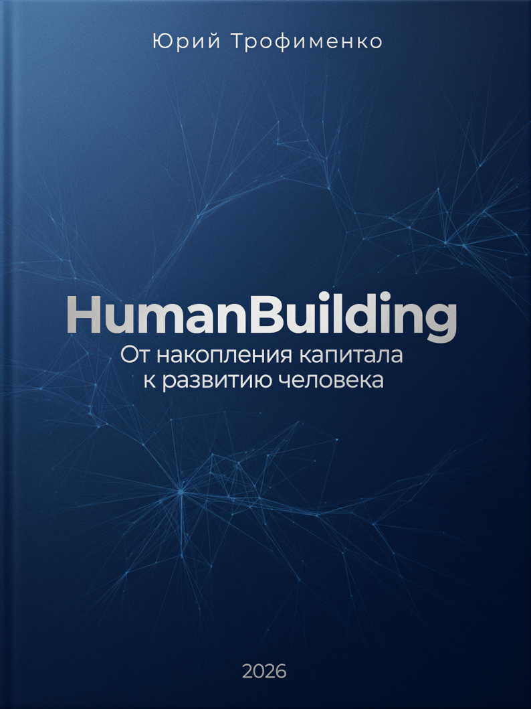

{width="6.267716535433071in"
height="8.36111111111111in"}

Юрий Трофименко

HumanBuilding

От накопления капитала к развитию человека

«Мы поклонялись стреле технического прогресса и забыли об отдаче.

Пришло время измерять прогресс развитием самого человека»

2026

Аннотация

На протяжении тысячелетий человечество измеряло свой прогресс внешним
продуктом: вещами, которые мы создаем, деньгами, которые копим,
империями, которые строим. Мы поклонялись стреле и забывали об отдаче от
выстрела.

Эта книга обращает внимание на недостающую составляющую уравнения:
развитие личности в акте созидания чего-либо внешнего. В ней
прослеживается, как возможность относительно свободного приращения
внутреннего богатства систематически присваивалась правящими классами.
Диагностируются три сходящихся кризиса позднего капитализма,
анализируются прецеденты прошлых попыток построить «лучший мир» и
предлагается практический «Стартовый набор» для современного
ЭйчБи-прогрессора.

Конец предыстории начинается не с глобальной катастрофы. Он начинается
во вторник вечером, в гостиной, в гараже или в цифровом чате, когда
небольшая группа людей решает перестать измерять свою жизнь деньгами и
начать измерять её степенью свободного человеческого развития.

**Отсканируйте, чтобы присоединиться к глобальному сообществу
ЭйчБи-прогрессоров**

{width="4.166666666666667in"
height="4.166666666666667in"}

*Эта работа адаптирована и распространяется с целью содействия
свободному развитию человечества. Вы можете делиться ею, переводить и
развивать изложенные в ней идеи. Сопровождающие программные прототипы
имеют открытый исходный код (open-source).*

ОГЛАВЛЕНИЕ

**РАЗДЕЛ 1. ОСНОВЫ: НЕДОСТАЮЩЕЕ УРАВНЕНИЕ**
\...\...\...\...\...\...\...\...\...\...\...\...\... 4

1.1. Слепое пятно экономической логики
\...\...\...\...\...\...\...\...\...\...\...\...\...\...\...\...\...\...\...\...\...\...\.....
4

1.2. Понятие HumanBuilding (ЭйчБи)
\...\...\...\...\...\...\...\...\...\...\...\...\...\...\...\...\...\...\...\...\...\...\...\...\...\...
4

1.3. Исторический контекст: монополизация развития
\...\...\...\...\...\...\...\...\...\...\...\...\...\...\...\... 5

1.4. Эмпирические признаки сдвига: феномен пра-HB
\...\...\...\...\...\...\...\...\...\...\...\...\...\...\...\.... 5

1.5. Практические векторы для экспериментов
\...\...\...\...\...\...\...\...\...\...\...\...\...\...\...\...\...\...\...\.....
6

1.6. Переход к анализу
\...\...\...\...\...\...\...\...\...\...\...\...\...\...\...\...\...\...\...\...\...\...\...\...\...\...\...\...\...\...\...\...\...\.....
7

**РАЗДЕЛ 2. ИСТОРИЧЕСКИЕ МЕХАНИЗМЫ ПЕРЕНАПРАВЛЕНИЯ ВНУТРЕННЕГО
ПРОДУКТА**
\...\...\...\...\...\...\...\...\...\...\...\...\...\...\...\...\...\...\...\...\...\...\...\...\...\...\...\...\....
8

2.1. От констатации к анализу
\...\...\...\...\...\...\...\...\...\...\...\...\...\...\...\...\...\...\...\...\...\...\...\...\...\...\...\...\...\...
8

2.2. Первичная монополизация: от изобилия к иерархии
\...\...\...\...\...\...\...\...\...\...\...\...\...\.... 8

2.3. Институционализация разделения
\...\...\...\...\...\...\...\...\...\...\...\...\...\...\...\...\...\...\...\...\...\...\...\.....
8

2.4. Капиталистическая трансформация
\...\...\...\...\...\...\...\...\...\...\...\...\...\...\...\...\...\...\...\...\...\...\...\...
9

2.5. Почему это работает: структурные механизмы
\...\...\...\...\...\...\...\...\...\...\...\...\...\...\...\...\...\...
10

2.6. Противоречия системы
\...\...\...\...\...\...\...\...\...\...\...\...\...\...\...\...\...\...\...\...\...\...\...\...\...\...\...\...\...\...\....
10

2.7. Переход к диагностике
\...\...\...\...\...\...\...\...\...\...\...\...\...\...\...\...\...\...\...\...\...\...\...\...\...\...\...\...\...\...\.....
11

**РАЗДЕЛ 3. ДИАГНОСТИКА: СИСТЕМНЫЕ ПРЕДЕЛЫ НАКОПЛЕНИЯ**
\...\...\...\...\...\...\...\...\...\.... 12

3.1. Экологический кризис: конфликт бесконечного роста и конечной среды
\...\..... 12

3.2. Военный кризис: утилизация капитала через разрушение
\...\...\...\...\...\...\...\...\...\...\... 12

3.3. Психологический кризис: виртуализация и фрагментация субъекта
\...\...\...\...\.... 13

3.4. Взаимосвязь кризисов и объективный тупик
\...\...\...\...\...\...\...\...\...\...\...\...\...\...\...\...\...\.....
14

**РАЗДЕЛ 4. ПРЕЦЕДЕНТЫ И ИСТОРИЧЕСКИЙ ОПЫТ**
\...\...\...\...\...\...\...\...\...\...\..... 15

4.1. От диагностики к историческому анализу
\...\...\...\...\...\...\...\...\...\...\...\...\...\...\...\...\...\...\...\.....
15

4.2. Ауровиль: город, который должен был породить новое человечество
\...\...\...\...\... 15

4.3. Твин Оукс: коммуна, которая отказалась умирать
\...\...\...\...\...\...\...\...\...\...\...\...\...\...\...\... 16

4.4. Кладбище утопий: Новая Гармония, Брук Фарм, Новая Одесса
\...\...\...\...\...\...\...\.... 16

4.5. СССР: крупнейший эксперимент в истории
\...\...\...\...\...\...\...\...\...\...\...\...\...\...\...\...\...\...\.....
16

4.6. FaSinPat: фабрика без начальников
\...\...\...\...\...\...\...\...\...\...\...\...\...\...\...\...\...\...\...\...\...\...\...\...
17

4.7. Паттерн: чему нас учит история
\...\...\...\...\...\...\...\...\...\...\...\...\...\...\...\...\...\...\...\...\...\...\...\...\...\....
17

**РАЗДЕЛ 5. ИНСТРУМЕНТАРИЙ: ИНФРАСТРУКТУРА ДЛЯ ЭЙЧБИ-ПРОГРЕССОРСТВА**
\...\...\...\...\...\...\...\...\...\...\...\...\...\...\...\...\...\...\...\...\...\...\...\...\...\...\...\...\...
19

5.1. От концепции к техническим спецификациям
\...\...\...\...\...\...\...\...\...\...\...\...\...\...\...\...\...\...
19

5.2. Картография развития: MySkillsOrganizer и Emberly
\...\...\...\...\...\...\...\...\...\...\...\...\...\.... 19

5.3. Экономика развития: CTFinder
\...\...\...\...\...\...\...\...\...\...\...\...\...\...\...\...\...\...\...\...\...\...\...\...\...\.....
20

5.4. Поиск и координация: ComradFinder и HistMathica
\...\...\...\...\...\...\...\...\...\...\...\...\...\...\... 20

5.5. Живые архивы: Common Books и Autobiography Platform
\...\...\...\...\...\...\...\...\...\...\...\... 21

5.6. Физическое укоренение: Public Garden
\...\...\...\...\...\...\...\...\...\...\...\...\...\...\...\...\...\...\...\...\...\....
21

5.7. Открытый исходный код как метод
\...\...\...\...\...\...\...\...\...\...\...\...\...\...\...\...\...\...\...\...\...\...\...\....
22

**РАЗДЕЛ 6. СИНТЕЗ: ЗАВЕРШЕНИЕ СТАНОВЛЕНИЯ**
\...\...\...\...\...\...\...\...\...\...\...\.... 23

6.1. От анализа к практике
\...\...\...\...\...\...\...\...\...\...\...\...\...\...\...\...\...\...\...\...\...\...\...\...\...\...\...\...\...\...\.....
23

6.2. Стартовый набор: Первые 90 дней
\...\...\...\...\...\...\...\...\...\...\...\...\...\...\...\...\...\...\...\...\...\...\...\.....
23

6.3. Преодоление неизбежного «трения»
\...\...\...\...\...\...\...\...\...\...\...\...\...\...\...\...\...\...\...\...\...\...\....
24

6.4. Рекомендуемые ресурсы для углубления
\...\...\...\...\...\...\...\...\...\...\...\...\...\...\...\...\...\...\...\...\....
25

6.5. Эпилог: Конец предыстории начинается здесь
\...\...\...\...\...\...\...\...\...\...\...\...\...\...\...\...\...\...
27

**КОНТАКТЫ И ПРИСОЕДИНЕНИЕ К ДВИЖЕНИЮ**
\...\...\...\...\...\...\...\...\...\...\...\...\...\... 28

# РАЗДЕЛ 1. ОСНОВЫ: НЕДОСТАЮЩЕЕ УРАВНЕНИЕ

## 1.1. Слепое пятно экономической логики

Любая экономическая система оценивает свою эффективность по внешним
показателям: объёму произведенных товаров, накопленному капиталу, темпам
роста ВВП или количеству построенной инфраструктуры. Капитализм довел
эту логику до совершенства, превратив внешний продукт в единственную
измеряемую ценность.

Однако у любого процесса преобразования мира есть обратная сторона.
Когда мы воздействуем на внешнюю среду, этот процесс неизбежно меняет
нас самих. Кузнец, формирующий металл, одновременно формирует свою
моторику, терпение и понимание материала. Программист, пишущий код,
развивает абстрактное (в хорошем смысле слова) мышление и способность к
структурированию информации.

Проблема не в том, что это развитие не происходит. Проблема в том, что
оно системно игнорируется как самостоятельная ценность. Человечество,
покорившее атом, расшифровавшее геном и построившее глобальную сеть, так
и не осознало, как справиться с им же порождённой стихией и как
перевести собственное развитие из режима вынужденной адаптации в режим
свободного роста. Мы научились измерять всё, кроме того, что происходит
с производителем в процессе производства.

## 1.2. Понятие HumanBuilding (ЭйчБи)

Чтобы работать с этим явлением, ему требуется точное определение.

**ЭйчБи (HumanBuilding)** --- это целенаправленное преобразование
объективного мира отдельными людьми (а через них и обществом в целом), в
процессе которого они обретают и развивают собственные способности,
постигая через конечное --- бесконечное.

**ЭйчБи-богатство** --- это интегральная совокупность знаний, навыков,
компетенций и «внутренних миров», приобретаемых в этом процессе. В
отличие от материального капитала, его нельзя механически передать,
продать или отнять. Оно неотделимо от носителя.

Капитал движется в цикле:

**Деньги → Товар → Деньги (Д--Т--Д\')**

Цикл ЭйчБи:

**ЭйчБиV → Практика → ЭйчБиV\'**

Человек начинает с определенного набора компетенций (ЭйчБиV).
Сталкиваясь с задачей, превышающей текущие возможности (культурный
недостаток), он вовлекается в практику. В результате он выходит из
ситуации с расширенным потенциалом (ЭйчБиV\'). При капитализме этот
естественный цикл перехватывается: практика организуется не для роста
ЭйчБиV\' и даже не для обеспечения людей полезными вещами и услугами, а
исключительно ради извлечения прибавочной стоимости, что часто приводит
к деградации или стагнации «внутреннего продукта».

## 1.3. Исторический контекст: монополизация развития

На протяжении истории классовых обществ происходила структурная
монополизация времени и условий для развития. Правящие классы
присваивали себе право на «Культуру с большой буквы» (философию, науку,
искусство), оставляя большинству «культуру с маленькой буквы» --- набор
привычек и навыков, необходимых исключительно для выживания и
обслуживания системы.

Капитализм не отменил это разделение, а видоизменил его. Он предоставил
формально всеобщую доступность знаний, но одновременно запустил процесс
управляемой фрагментации личности. Вместо целостного развития человеку
предлагается набор изолированных модулей потребления: фитнес для тела,
стриминг для досуга, узкопрофессиональные курсы для карьеры. Это не
свободное развитие субъекта, а тонкая настройка потребителя под
определённые рыночные ниши.

## 1.4. Эмпирические признаки сдвига: феномен пра-HB

Есть и точечные исключения, существующие в тени правила, подобно первым
мелким млекопитающим, снующим под ногами у динозавров. В разных точках
планеты, независимо друг от друга, возникают практики, не
соответствующие напрямую логике максимизации прибыли.

Назовём это **пра-HB-культурой**. Это стихийные попытки людей выстроить
жизнь вокруг многовекторного саморазвития, еще не оформленные в
осознанное общественное движение.

- **Кейс 1: Открытые базы навыков.** Существуют инженеры и
  исследователи, которые тратят часть своего времени не на монетизацию
  хобби, а на создание бесплатных структурированных баз данных навыков и
  их взаимосвязей. Для них помощь в структурировании чужого развития
  является самостоятельной ценностью.

- **Кейс 2: Гаражные фаблабы.** Группы энтузиастов организуют
  пространства с ЧПУ-станками и 3D-принтерами не как коммерческие
  сервисы, а как площадки для взаимного обучения. Как отмечают сами
  организаторы, их цель --- не продать прототип, а создать условия, при
  которых человек задаст себе вопрос: «Могу ли я сделать это сам?».

- **Кейс 3: Межпоколенческие творческие коллективы.** Объединения, где
  подростки и взрослые участвуют, например, в археологических или
  художественных проектах не в формате «учитель-ученик», а как соавторы.
  Это ломает иерархическую модель передачи знаний, заменяя ее совместным
  приращением компетенций.

Объединяет эти кейсы одно: стирание жёсткой границы между «рабочим» и
«свободным» временем. Свободная деятельность непосредственно становится
источником внутреннего роста, а не средством заработка.

## 1.5. Практические векторы для экспериментов

Ниже приведены 7 направлений, которые можно протестировать в текущих
условиях, не требуя революционных жертв.

1)  Смена метрики на рабочем месте. Если возможно, попробуйте внедрить
    пилотный проект, где успех измеряется не только KPI по объему, но и
    индексом освоения новых навыков сотрудниками. Это проверяемая
    гипотеза: повышает ли это в долгосрочной перспективе эффективность
    команды?

2)  Создание локальных сетей обмена компетенциями. Вместо поиска работы
    используйте локальные чаты или платформы для поиска задач, где
    ценностью является не оплата, а возможность получить опыт в новой
    области (прототип CTFinder).

3)  Визуализация собственного ЭйчБи-богатства. Потратьте время на
    составление не просто резюме, а карты своих компетенций,
    показывающей зависимости навыков (по аналогии с логикой
    MySkillsOrganizer или Emberly). Это меняет фокус с «где я работал»
    на «что я реально умею и как это связано».

4)  Кружки самообразования в гуманитарной сфере. Неформальные встречи
    небольших групп для разбора первоисточников (философия, история,
    политэкономия) для выработки единого методологического базиса
    понимания реальности.

5)  Ревитализация заброшенных пространств. Инициативы по совместному
    уходу за общественными садами, парками и так далее. Это не просто
    экология, это способ на практике проверить возможность
    бесконфликтной кооперации без денежного посредничества.

6)  Сбор структурированных автобиографий. Фиксация опыта раннего
    развития. Это не мемуары, а сбор сырых данных для понимания того,
    какие условия реально способствуют формированию целостной личности.

7)  Интеграция с существующими HB-ориентированными пространствами.
    Поддержка или участие в деятельности существующих фаблабов или
    открытых образовательных проектов, где приоритетом является развитие
    участника.

## 1.6. Переход к анализу

Концепция ЭйчБи - это констатация фундаментального механизма
человеческого существования, который тысячелетиями перенаправлялся в
русло, выгодное для поддержания классовых структур.

Если развитие человека --- это естественный процесс, почему он до сих
пор не стал основной целью организации общества? Почему система,
обладающая беспрецедентными технологиями, продолжает воспроизводить
фрагментированных, несвободных людей?

Ответ на этот вопрос требует не эмоциональных обвинений, а холодного
структурного анализа. В следующем разделе мы рассмотрим исторические и
политэкономические механизмы, которые системно перехватывали и
перенаправляли внутренний продукт человеческой деятельности.

# РАЗДЕЛ 2. ИСТОРИЧЕСКИЕ МЕХАНИЗМЫ ПЕРЕНАПРАВЛЕНИЯ ВНУТРЕННЕГО ПРОДУКТА

## 2.1. От констатации к анализу

В предыдущем разделе мы зафиксировали фундаментальный факт: в процессе
преобразования внешнего мира человек неизбежно развивает собственные
способности. Этот процесс --- ЭйчБи --- происходит постоянно, независимо
от того, осознаётся он или нет.

Возникает вопрос: если это развитие столь фундаментально, почему оно не
стало основой организации общества? Почему системы, обладающие ресурсами
для всеобщего развития, продолжают воспроизводить фрагментированных,
ограниченных в развитии индивидов?

Ответ требует анализа не морального (кто виноват?), а структурного (как
это работает?). На протяжении истории классовых обществ складывались
механизмы, которые системно перенаправляли внутренний продукт
человеческой деятельности в пользу ограниченных групп.

## 2.2. Первичная монополизация: от изобилия к иерархии

В доклассовых обществах, где средства производства находились в общем
пользовании, развитие каждого члена коллектива было условием выживания
всего коллектива. Охотник, обучавшийся отслеживать добычу, развивал
наблюдательность, терпение, понимание экологии --- и передавал эти
навыки другим. Здесь не было разделения на \"развивающихся\" и
\"обслуживающих\".

С появлением устойчивого избытка продукта возникла возможность для части
общества не участвовать непосредственно в производстве средств
существования. Эта часть получила время для развития специализированных
навыков: управления, военного дела, жреческих практик, позднее ---
письменности и философии.

Одна группа монополизировала условия, потенциально пригодные для
комплексного развития, а другая была ограничена условиями развития,
необходимого непосредственно для производства внешнего продукта.

## 2.3. Институционализация разделения

По мере усложнения обществ это разделение закреплялось институционально:

**Древнейшие цивилизации**. В Египте, Месопотамии, Китае жреческие и
чиновничьи касты монополизировали грамотность, астрономию, математику,
медицину. Миллионы сельских работников, строителей пирамид,
ирригационных систем, городских стен оставались вне доступа к этим
знаниям. Их развитие ограничивалось навыками, необходимыми для
выполнения конкретных работ.

**Античность**. Афинская демократия создала условия для беспрецедентного
развития граждан --- в философии, политике, искусстве, атлетике. Но это
развитие базировалось на труде рабов, чьё собственное свободное развитие
системно подавлялось. Идеал \"целостной личности\" был идеалом
рабовладельца, а не человека вообще.

**Средневековье**. Христианская теология предложила универсалистскую
идею: каждый человек имеет бесконечную ценность в глазах Бога. Но на
практике это привело к переносу центра развития из земной жизни в
загробную. Все богатство человеческих способностей проецировалось на
божественную сущность, а земное существование объявлялось временным
испытанием. Монахи, переводившие и переписывавшие античные тексты, не
могли развивать критическое мышление в той мере, в какой это делали
античные философы --- догматические рамки ограничивали развитие даже
внутри привилегированной группы.

## 2.4. Капиталистическая трансформация

Капитализм не отменил монополизацию развития, но радикально изменил её
механизм.

**Формальное освобождение**. В отличие от раба или крепостного, наёмный
работник формально свободен. Он может учиться, читать, путешествовать,
развивать себя. Капитализм создал материальные предпосылки для всеобщего
развития: массовое образование, доступ к информации, сокращение рабочего
дня.

**Фактическая фрагментация**. Однако логика накопления капитала требует,
чтобы работник оставался заменяемым элементом производственного
процесса. Полное, многовекторное развитие работника противоречит этой
логике, так как делает его менее управляемым и более требовательным к
условиям труда.

Решение, которое нашёл капитализм: предложить развитие, но в
фрагментированной, контролируемой форме. Вместо целостного развития
личности --- набор узкоспециализированных навыков для рынка труда.
Вместо критического мышления --- потребление готовых культурных
продуктов. Вместо самоуправления --- выбор между предопределёнными
опциями.

**Третье подразделение производства**. Как отмечает исследователь Марина
Бурик, поздний капитализм создал специализированное подразделение по
производству потребителей. Реклама, массовая культура, индустрия
развлечений не просто продают товары --- они формируют тип личности, для
которого потребление является основным способом самореализации. Это не
заговор, а системная логика: для непрерывного накопления капитала нужны
люди, чьи потребности постоянно генерируются и никогда полностью не
удовлетворяются.

## 2.5. Почему это работает: структурные механизмы

Перенаправление внутреннего продукта не требует сознательного заговора
элит. Оно воспроизводится через структурные механизмы.

### Экономическое принуждение

Человек, вынужденный тратить 40-60 часов в неделю на работу ради
выживания, не имеет ни времени, ни энергии для комплексного
саморазвития. Его развитие ограничивается теми навыками, которые
повышают его рыночную стоимость.

Институциональная инерция

Образовательные системы, даже декларируя цель развития личности, на
практике воспроизводят иерархии и специализации, необходимые для
функционирования экономики.

Культурная гегемония

Доминирующие представления о \"успехе\", \"нормальности\",
\"реалистичных целях\" сужают пространство воображаемого. Человек не
стремится к тому, что не может представить как возможное.

Индивидуализация проблем

Системные ограничения развития преподносятся как личные неудачи: \"ты
недостаточно мотивирован\", \"у тебя нет таланта\", \"ты не умеешь
управлять временем\". Это направляет энергию человека на самобичевание.

## 2.6. Противоречия системы

Однако капитализм содержит внутреннее противоречие, которое создаёт
возможности для изменения.

Для функционирования современной экономики требуются высокообразованные,
творческие, способные к самоуправлению работники. Капитализм вынужден
производить таких людей --- но не может позволить им полностью
реализоваться, так как это подрывает саму логику наёмного труда.

Это противоречие проявляется в растущем разрыве между декларируемыми
ценностями (свобода, развитие, самореализация) и реальной практикой
(отчуждение, фрагментация, выгорание). Именно этот разрыв создаёт почву
для пра-HB-практик, о которых говорилось в Разделе 1.

## 2.7. Переход к диагностике

Исторический анализ показывает, что перенаправление внутреннего продукта
--- не случайность и не результат чьей-то злой воли. Это особенность
классовых обществ, которая принимает разные формы в разные эпохи.

Но если этот механизм столь устойчив, почему мы говорим о возможности
его преодоления именно сейчас? Ответ лежит в анализе современных
кризисов, которые показывают, что система, основанная на бесконечном
накоплении внешнего продукта в ущерб внутреннему развитию, достигает
объективных пределов.

В следующем разделе мы рассмотрим три взаимосвязанных кризиса ---
экологический, военный и психологический --- как проявления системных
ограничений позднего капитализма.

# 

# 

# 

# 

# РАЗДЕЛ 3. ДИАГНОСТИКА: СИСТЕМНЫЕ ПРЕДЕЛЫ НАКОПЛЕНИЯ

## 3.1. Экологический кризис: конфликт бесконечного роста и конечной среды

Условием существования капитала является его бесконечное расширенное
воспроизвордство. Каждый последующий цикл должен приносить больше
внешнего продукта (прибыли), чем предыдущий. Однако эта математическая
модель вступает в прямое противоречие с физическими законами замкнутой
системы --- планеты Земля.

Система рассматривает окружающую среду как источник сырья и свалку для
части отходов, не подлежащих переработке или ожидающих её. Экологический
кризис --- это не «ошибка» или «небрежность» корпораций, а закономерный
результат нормального функционирования, требующего минимизации затрат
без оглядки на побочные эффекты, которые не мешают росту бизнеса в
краткосрочной перспективе.

Парадокс заключается в том, что технологии для смягчения кризиса уже
существуют (возобновляемая энергетика, замкнутые циклы производства, и,
возможно, на подходе также управляемый термоядерный синтез). Проблема не
в отсутствии научных решений, а в отсутствии социально-экономического
механизма для их внедрения. Переход на «зелёные» рельсы требует
колоссальных первоначальных инвестиций и снижения текущей
маржинальности, что противоречит логике квартальной прибыли. Пока
экологическая катастрофа не угрожает непосредственно физическому
существованию центров накопления капитала, система будет выбирать
тактику откладывания затрат, перекладывая экологические издержки на
периферию и будущие поколения.

## 3.2. Военный кризис: утилизация капитала через разрушение

Второй предел системы кроется в проблеме перепроизводства. Капитализм
постоянно производит больше внешнего продукта, чем рынок способен
поглотить с прибылью. Чтобы избежать коллапса от затоваривания, системе
необходимо регулярно уничтожать избыточную стоимость.

Война в этом контексте --- не провал дипломатии, а высокоэффективный
экономический инструмент. Она решает сразу несколько задач:

1)  **Физическое уничтожение капитала.** Бомбардировки заводов,
    инфраструктуры и городов ликвидируют накопленную стоимость,
    освобождая место для нового цикла строительства и производства.

2)  **Формирование нового спроса.** Послевоенное восстановление создает
    гарантированный рынок сбыта на десятилетия вперед.

3)  **Концентрация ресурсов.** Военно-промышленный комплекс является
    одним из немногих секторов, где государство гарантирует сверхприбыли
    и берет на себя все риски, выступая идеальным партнером для
    монополий.

Этот механизм работает как клапан сброса давления. Локальные конфликты,
гонка вооружений и периодические эскалации --- это не аномалии, а
встроенные функции позднего капитализма, необходимые для поддержания
оборотов машины накопления.

## 3.3. Психологический кризис: виртуализация и фрагментация субъекта

Третий, и, возможно, самый глубокий кризис, касается самого
производителя --- человека. Если первые два кризиса угрожают внешним
условиям существования, то этот угрожает самой сущности воспроизводства
человечества.

Как было показано в Разделе 2, современному капитализму необходимо не
просто производить товары, но и производить потребителей (третье
подразделение). Для этого требуется личность с дефицитом, с постоянно
генерируемыми, но никогда не удовлетворяемыми до конца желаниями.
Целостная, самодостаточная личность, занимающаяся свободным ЭйчБи,
экономически «невыгодна»: ей не нужно стремиться покупать всё подряд без
меры, чтобы чувствовать себя полноценной.

Поэтому система стимулирует фрагментацию сознания. Вместо развития
целостного мировоззрения человеку предлагается бесконечный поток
изолированных стимулов: коротких видео, новостных триггеров,
микро-удовольствий. Это приводит к эпидемии выгорания, тревожности и
потери смысла --- тому, что Кундера назвал «невыносимой лёгкостью
бытия».

Закономерным финалом этого процесса является тотальная виртуализация -
на сей раз уже не в политэкономическом, а в техническом смысле. Когда
мир становится слишком сложным, тревожным и требующим усилий для
преобразования (то есть для настоящего ЭйчБи), система предлагает
суррогат. Нейроинтерфейсы, метавселенные и алгоритмические ленты создают
идеальную среду, где потребление максимально упрощено, а обратная связь
от внешнего мира устремляется к нулю. Это путь к окончательному
отчуждению человека от его собственной способности преобразовывать
реальность и, следовательно, от его внутреннего продукта.

## 3.4. Взаимосвязь кризисов и объективный тупик

Эти три кризиса не существуют изолированно. Они образуют замкнутый цикл
обратной связи:

- Экологическая нехватка ресурсов обостряет конкуренцию и провоцирует
  военные конфликты.

- Военные конфликты и климатическая нестабильность повышают уровень
  стресса, что подталкивает людей к психологическому эскапизму и
  виртуальному потреблению.

- Психологическая фрагментация и апатия лишают общество воли и
  способности к коллективным действиям, необходимым для решения
  экологических и военных проблем.

Система, основанная на приоритете внешнего продукта, исчерпала свою
историческую роль. Она близка к утрате способности обеспечивать даже
базовое выживание человечества, не говоря уже о его свободном развитии.
Переход к обществу, где ЭйчБи является главной целью, перестает быть
просто этической утопией --- он становится жестким условием физического
выживания человечества.

Но если система не может стихийно, "автоматически" изменить себя
изнутри, где искать ресурсы для перемен? Ответ на этот вопрос требует
обращения к историческому опыту. В следующем разделе мы проанализируем
конкретные попытки построить альтернативные модели общества --- от
утопических коммун XIX века до рабочих самоуправлений и индустриальных
экспериментов XX века, --- чтобы понять, что из этого сработало, а что
потерпело крах, и почему.

# РАЗДЕЛ 4. ПРЕЦЕДЕНТЫ И ИСТОРИЧЕСКИЙ ОПЫТ

## 4.1. От диагностики к историческому анализу

В предыдущем разделе мы зафиксировали, что система, ориентированная
исключительно на бесконечное накопление внешнего продукта, упирается в
объективные экологические, военные и психологические пределы. Если
внутренние механизмы системы не позволяют ей измениться стихийно, где
искать ресурсы для перехода?

Ответ требует обращения к историческому опыту. На протяжении последних
двух столетий предпринимались попытки построить альтернативные модели
общества --- от утопических коммун XIX века до рабочих самоуправлений и
индустриальных экспериментов XX века. Мы не будем искать в них готовые
чертежи --- их не существует. Наша задача --- выявить и проанализировать
паттерны: что сработало, что потерпело крах, и почему.

## 4.2. Ауровиль: город, который должен был породить новое человечество

Начнем с самого амбициозного эксперимента. В 1968 году в Индии был
основан Ауровиль. Его устав провозглашал создание универсального города,
где люди всех стран живут в мире, вне религий и национальностей, а труд
является не способом заработка, а средством самовыражения и развития.

Прошло более полувека. Ауровиль выжил, но не стал «зерном» новой
цивилизации. Почему? Во-первых, идеологическая основа. Пропаганда
основательницы (Матери) представляет собой смесь интуиции и откровенного
мистицизма (вплоть до заявлений о перемещении столов «витальной силой»).
Это отталкивает научно мыслящих людей, способных создать строгий
теоретический фундамент. Во-вторых, экономика. Ауровиль не
самодостаточен. Он существует как «духовный индустриальный парк» внутри
глобального капитализма, завися от туризма и внешних доходов. Для
обычного трудящегося без внешних ресурсов жизнь там мало отличается от
жизни «во внешнем мире».

**Урок**: Коммуна, не ставящая во главу угла системное развитие ЭйчБи
каждого участника и опирающаяся на мистицизм, неизбежно втягивается в
логику окружающего общества.

## 4.3. Твин Оукс: коммуна, которая отказалась умирать

Совершенно иной подход был применен в Вирджинии (США), где в 1967 году
основали коммуну Твин Оукс. Здесь нет мистики. Есть жесткая система: 42
часа труда в неделю в обмен на жилье, еду и медицину. Никакой частной
собственности, никаких начальников, решения принимаются коллективно.

Спустя более 50 лет она существует и даже вдохновила новых энтузиастов
на создание дружественных коммун. Частая ротация задач (сегодня делаешь
тофу, завтра индексируешь книги, послезавтра работаешь в саду)
предотвращает фрагментацию личности --- это эффективная форма
политехнического ЭйчБи.

Но Твин Оукс --- это крошечный «остров». Она не «заражает» окружающее
общество, как это делал ранний капитализм. Она искусственно ограничивает
численность (около 100 человек) и совсем незначительно горизонтально
масштабируется. Более того, она малопривлекательна для молодежи,
отрезанной от современных благ, скоростного интернета и культурного
разнообразия мегаполисов. Это скорее скромное убежище от невзгод
настоящего, а не его замена.

**Урок**: Рациональная организация может создать локальный «карман»
свободы, но не способна стать универсальным шаблоном.

## 4.4. Кладбище утопий: Новая Гармония, Брук Фарм, Новая Одесса

XIX век оставил нам ряд поучительных провалов, вскрывающих
фундаментальные противоречия ранних экспериментов.

Роберт Оуэн купил «Новую Гармонию» в США, но колонисты, не привыкшие к
физическому труду, быстро расслоились на «интеллигенцию» и
«простолюдинов». В «Брук Фарме» интеллектуалы пытались сочетать
умственный и ручной труд, но 10-часовой день на полях истощал их, не
оставляя сил ни на что более. Уильям Фрей основал свою мини-коммуну с
жестким вегетарианством и отменой брака, но суровые условия и
авторитарные правила привели к быстрому развалу.

**Урок:** Невозможно построить пост-капиталистическое общество на базе
примитивного ручного труда. Низкая производительность оставляет нет
времени для высокого ЭйчБи. Кроме того, образ жизни нельзя навязать
сверху --- он должен вырастать из реальных потребностей и опыта
участников.

## 4.5. СССР: крупнейший эксперимент в истории

Советский Союз был самой масштабной попыткой. Это не было обществом
полностью свободного ЭйчБи. Как отмечал исследователь Юрий Семенов, это
была форма индустриального политаризма: государство и правящий класс
слились, а прибавочный продукт перераспределялся через бесплатное жилье,
медицину и образование.

СССР был был составляющей глобального капитализма. Советское государство
функционировало как единая корпорация на мировом рынке, конкурируя с
Западом за ресурсы и технологии. Пятилетки были планом ускоренного
накопления, что требовало интенсивной эксплуатации труда.

Индустриализация, победа над фашизмом, космос, всеобщая грамотность ---
это достижения, недоступные многим «классическим» капиталистическим
странам. Для ученых, инженеров, космонавтов были созданы реальные
условия для ЭйчБи. Но почему система деградировала? Не только из-за
отсталого наследия Российской Империи. Даже в более развитой Германии
она столкнулась бы с тем же противоречием: необходимостью конкурировать
с глобальным капиталом, что требовало приоритета накопления над
свободным развитием граждан.

**Урок:** Пост-капиталистическое общество невозможно построить в одной
отдельно взятой стране, окруженной враждебным рынком, и невозможно
построить государством, которое неизбежно само действует как капиталист,
эксплуатируя своих работников - граждан.

## 4.6. FaSinPat: фабрика без начальников

В 2001 году в Аргентине рабочие захватили заброшенный завод Zanon и
переименовали его в FaSinPat («Фабрика без хозяев»). Координаторы
избирались и могли быть отозваны, решения принимались на общих
собраниях. Завод работает до сих пор.

Но это все еще капиталистическое предприятие, просто коллективно
управляемое рабочими. Оно вынуждено конкурировать на рынке, гнаться за
прибылью и эффективностью, чтобы выжить. Постепенно координаторы
превращаются в де-факто менеджеров, а логика рынка подавляет логику
свободного развития каждого работника.

**Урок**: Рабочее самоуправление --- необходимый шаг, но недостаточный.
Пока предприятие встроено в рыночную конкуренцию, оно неизбежно
воспроизводит старые отношения.

## 4.7. Паттерн: чему нас учит история

Что объединяет все эти эксперименты? Они пытались построить новое
общество внутри старого. И каждый раз обнаруживали, что старое общество
сильнее. Оно втягивает любые альтернативы в свою логику, превращает их в
ниши рынка или изолированные резервации.

Означает ли это, что проект безнадежен? Нет. Это означает, что переход
не может быть осуществлен ни изолированными коммунами, ни
государствами-крепостями, ни индивидуальным примером. Требуется нечто
иное --- ЭйчБи-прогрессорство. Сознательная, научно обоснованная
стратегия строительства нового общества в симбиозе со старым, с
использованием его же ресурсов до тех пор, пока старое не станет
избыточным.

Но как это сделать на практике? Какие инструменты, концепции и
инфраструктура нужны для того, чтобы превратить стихийные пра-HB-вспышки
в осознанное движение пред-HB? Ответ на эти вопросы мы рассмотрим в
следующем разделе.

# РАЗДЕЛ 5. ИНСТРУМЕНТАРИЙ: ИНФРАСТРУКТУРА ДЛЯ ЭЙЧБИ-ПРОГРЕССОРСТВА

## 5.1. От концепции к техническим спецификациям

В предыдущих разделах мы обосновали необходимость перехода от стихийных
пра-HB-практик к осознанному пред-HB-строительству. Но любая стратегия
требует инструментов. Стихийные попытки создать альтернативные формы
жизни терпели крах не только из-за идеологических или экономических
причин, но и из-за отсутствия инфраструктуры, способной связать
разрозненные инициативы в единый процесс.

В этом разделе мы рассмотрим конкретные технические концепции и
прототипы, разработанные как базовые элементы такой инфраструктуры.
Важно сразу обозначить: это не готовые продукты. Это в основном
концептуальные спецификации и черновые прототипы, созданные в
определенных непростых условиях и по определенным причинам остановленные
в развитии. Их ценность --- в проработанной логике и открытости для
доработки сообществом.

## 5.2. Картография развития: MySkillsOrganizer и Emberly

С точки зрения ЭйчБи проблема традиционного резюме в том, что оно
фиксирует в большей степени места работы, чем компетенции и их
взаимосвязи. Для осознанного ЭйчБи-прогрессорства требуется иной
инструмент --- интерактивная визуальная карта развития.

MySkillsOrganizer
([[https://my-skills-organizer-supabase.vercel.app]{.underline}](https://my-skills-organizer-supabase.vercel.app))
решает задачу отображения последовательных зависимостей навыков. Это
интерактивное дерево, где каждый узел --- освоенная компетенция, а связи
показывают, какие навыки являются prerequisites для других. Например,
узел \"Разработка веб-приложений\" требует предварительного освоения
\"Основ программирования\" и \"Работы с базами данных\". Такая
визуализация позволяет не только отслеживать собственный прогресс, но и
делиться проверенными траекториями развития с другими.

Emberly ([[https://ember.ly]{.underline}](https://ember.ly)) решает
смежную, но несколько иную задачу --- категоризацию направлений
развития. Если MySkillsOrganizer показывает последовательность, то
Emberly дает мгновенный срез многовекторности личности: ветви
\"Волонтерство\", \"Языки\", \"Творческие практики\", \"Сообщество\".
Это инструмент для быстрого понимания структуры ЭйчБи-богатства
личности.

## 5.3. Экономика развития: CTFinder

Традиционный рынок труда организован вокруг товарного обмена. Работник
продаёт часть своего жизненного времени, в течение которого работодатель
направляет его рабочую силу на создание определённых товаров. Затем
работодатель продаёт результат чужого труда. Транзакция завершается
выплатой суммы, необходимой для восстановления рабочей силы ради
возможности следующего цикла производства. Развитие работника здесь не
является самостоятельной целью.

**CTFinder (Creative Tasks Finder)** предлагает альтернативную модель
--- платформу, где первичной валютой становится не деньги, а прирост
ЭйчБи исполнителей. Задачи размещаются не как вакансии, а как
возможности развития. Студенту нужен реальный проект для диплома,
организации нужен сайт --- они соединяются. Внешний продукт создается,
но внутренний продукт --- расширенные компетенции --- является главным
результатом.

Это не благотворительность и не волонтёрство в классическом смысле. Это
параллельная экономика, где ROI измеряется в компетенциях, уверенности и
связях сообщества.

## 5.4. Поиск и координация: ComradFinder и HistMathica

Стихийные пра-HB-практики часто остаются изолированными. Люди,
заинтересованные в целостном многовекторном развитии, существуют в
каждом городе, но не знают о существовании друг друга.

**ComradFinder** --- инструмент для преодоления этой изоляции. Вместо
алгоритмов, оптимизированных под удержание внимания (как в социальных
сетях), он использует сканирование публичных профилей по содержательным
параметрам, например: интерес к изучению и улучшению жизни человеческого
общества, к open-source разработке, к инициативам взаимопомощи и тому
подобное. Цель --- быстрое и точное соединение потенциальных со-творцов.

**HistMathica** (от \"история\" + \"математика\") --- это гипотетический
организационно-программный комплекс для автоматизации рутинных задач
прогрессорской деятельности. Это система для сбора данных, анализа и
стратегического планирования. Призвана помогать в выявлении \"ростков
будущего\" в настоящем методами DataMining и ему подобными.
Предполагается корректировка курса исследований при помощи обратной
связи: выявление алгоритмами ИстМатики особенных явлений в текущей жизни
общества - воздействие сообщества на основании полученных знаний -
наблюдение за развитием ситуации - перенацеливание ИстМатики.

## 5.5. Живые архивы: Common Books и Autobiography Platform

Знание --- топливо для ЭйчБи. Но миллионы книг пылятся на полках, а
миллионы жизненных историй исчезают не зафиксированными.

**Common Books** --- это адресная peer-to-peer сеть общественного
пользования физическими книгами. Пользователь каталогизирует домашнюю
библиотеку, отмечает часть книг: \"дам почитать\" или \"отдам
навсегда\". Кто-либо, кому определённая книга нужна, запрашивает её ---
происходит безвозмездная передача. Система отслеживает путь книги,
создавая сеть совместного знания и живых контактов. Это не буккроссинг
(где книги просто оставляются в случайных местах) и не библиотека (где
доступ ограничен институционально). Это целенаправленная передача.

**Autobiography Platform** решала бы задачу сбора данных о становлении
личности. Сырой материал для науки о человеческом развитии --- подробные
записи о том, как каждый человек стал тем, кто он есть. Особенно ценны
воспоминания о первых годах жизни. Сбор и исследование структурированных
автобиографий приблизил бы рождение первой настоящей, основанной на
точных данных науки о человеческом становлении. Мы сможем лучше понять,
какие условия реально способствуют формированию целостной личности, а не
действовать методом проб и ошибок.

## 5.6. Физическое укоренение: Public Garden

Все программные инструменты мира не заменят необходимости касаться
земли, видеть осязаемые результаты заботы и делиться урожаем. Наше ЭйчБи
должно быть укоренено в физическом мире.

**Public Garden** --- модель рекультивации заброшенных пространств:
пустырей, заросших садов, забытых парков. Правила просты: любой может
прийти и посадить. Любой может прийти и ухаживать. Любой может прийти и
съесть плоды, независимо от того, сажал ли он их. Никаких продаж.
Никакого права собственности. Только радость совместного выращивания и
общедоступный урожай.

В мире, где каждый клочок земли огорожен и каждый яблоко имеет ценник,
общественный сад --- это радикальный акт. Это физическое воплощение
принципа пред-HB: щедрость земли --- общее наследие, а акт совместного
возделывания --- фундаментальное человеческое право и источник
внутреннего богатства.

## 5.7. Открытый исходный код как метод

Все описанные инструменты --- это рычаги. А рычаг бесполезен без того,
кто готов его нажать.

Прототипы были созданы в определённое время и в определённых непростых
жизненных условиях, многие заморожены из-за жёстких реалий жизни в
позднем капитализме. Но их код, их логика, их дух открыты. Они ждут вас.

Вам не нужно разрешение для старта. Вам не нужны миллионы долларов
венчурного капитала. Вам нужен GitHub-аккаунт, сообщество из трех друзей
или заброшенный клочок земли в вашем районе.

Форкните репозиторий (например, MySkillsOrganizer на GitHub).
Адаптируйте концепцию. Создайте инструмент, нужный вашему сообществу.
Переведите интерфейс на ваш язык. Улучшите дизайн.

Старый мир строился теми, кто стремился владеть средствами производства.
Новый мир будет строиться теми, кто стремится овладеть средствами
человеческого развития и содействовать формированию условий
по-настоящему свободного творчества.

\"Чертежи\" - в ваших руках. Расследование завершено. Строительство
начинается.

В следующем разделе мы соберем все воедино: как отдельные инструменты,
локальные сады и кружки самообразования сплетаются в глобальное,
симбиотическое движение. Мы предоставим практический \"Starter Kit\" для
современного ЭйчБи-прогрессора: списки чтения, руководства по ведению
продуктивных обсуждений и пошаговые стратегии запуска вашей первой
пред-HB-инициативы без выгорания и кооптации.

# РАЗДЕЛ 6. СИНТЕЗ: ЗАВЕРШЕНИЕ СТАНОВЛЕНИЯ

## 6.1. От анализа к практике

В предыдущих разделах мы выстроили целостную картину. Мы зафиксировали
фундаментальный факт: преобразуя внешний мир, человек неизбежно
развивает собственные способности (ЭйчБи). Мы проанализировали, как
исторические и современные экономические системы структурно
перенаправляют этот внутренний продукт в пользу накопления внешнего
капитала, что привело систему к объективным экологическим, военным и
психологическим пределам. Мы изучили исторические прецеденты, сделав
вывод, что изолированные утопии обречены, а изменение возможно только
через симбиотическое строительство нового внутри старого. И, наконец, мы
рассмотрели определённые открытые инструменты, способные стать
инфраструктурой этого перехода.

Однако концепция ЭйчБи перестает быть абстракцией только тогда, когда
обретает форму конкретных, проверяемых действий. Теория без практики
мертва, но практика без теории слепа. Данный раздел предназначен для
того, чтобы соединить их, предоставив практический «Стартовый набор»
(Starter Kit) для современного ЭйчБи-прогрессора.

## 6.2. Стартовый набор: Первые 90 дней

Главная ошибка энтузиастов --- попытка спроектировать «идеальную
систему», тем более, чуть ли не за несколько дней. Написание масштабных
манифестов, поиск грантов или попытка запустить глобальную платформу в
одиночку неизбежно ведут к выгоранию или кооптации.

Подход пред-HB (осознанного переходного этапа) иной. Он итеративен,
локален и основан на микро-экспериментах. Ниже предлагается реалистичный
пример.

### Дни 1--15: Внутренний аудит и фокус

Прежде чем «развивать других», необходимо чётко понимать собственную
траекторию. Не пытайтесь сразу менять мир. Используйте логику
*MySkillsOrganizer* или *Emberly*: составьте карту своих текущих
компетенций, интересов и того «культурного недостатка», который вы
хотите восполнить. Определите 1--2 конкретных навыка, которыми вы готовы
не только овладеть, но и поделиться. Эта прозрачность и уязвимость ---
фундамент доверия.

Дни 16--30: Поиск резонанса

Не пытайтесь «переубедить массы». Используйте логику *ComradFinder*:
найдите 2--3 человек в вашем непосредственном окружении (офис,
университет, локальный чат района), которые уже задаются
соответствующими вопросами. Это может быть коллега, уставший от
бессмысленных KPI, или сосед, интересующийся городским озеленением.
Обратитесь к ним не с лекцией о глобальных проблемах, а с конкретным
предложением о взаимном обмене знаниями или совместном микро-проекте.

Дни 31--60: Запуск микро-проекта

Начните с небольшого масштаба. Не пытайтесь «свергнуть систему
образования» --- организуйте еженедельный разбор одной главы
философского или технического текста. Не пытайтесь «построить новую
экономику» --- создайте общую таблицу, где, допустим трое людей
предоставляют взаимные услуги (например: «я настраиваю вам Wi-Fi, а вы
учите меня основам работы с Excel»). Цель этого этапа не в решении
глобальной проблемы, а в том, чтобы на практике *прочувствовать*
динамику простейшего пред-HB и доказать себе, что она работает.

Дни 61--90: Рефлексия и итерация

Проведите мета-оценку. Не измеряйте успех в деньгах или объёме
произведенного внешнего продукта. Измеряйте ЭйчБи-богатство: «Какие
новые навыки мы приобрели? Изменилась ли наша уверенность? Стала ли
группа более сплоченной?» Задокументируйте это. На основе этих данных
скорректируйте курс: возможно, группа сузится до двух самых
мотивированных участников, или, наоборот, расширится. Система должна
быть самокорректирующейся, потому что ее главный «KPI» --- человеческий
рост, а не слепое следование «бизнес-плану».

## 6.3. Преодоление неизбежного «трения»

В процессе построения вы неизбежно столкнётесь с сопротивлением. Старая
система не сдается тихо; она истощает, изолирует или поглощает
прогрессивные инициативы. Вот как к этому подготовиться:

- **Ловушка выгорания.** Вы делаете это в свое «свободное» время,
  которое капитализм всегда стремится «колонизировать». *Антидот:*
  Защищайте свой отдых. Помните, что ЭйчБи --- это устойчивое, радостное
  развитие, а не самопожертвование ради «новой великой цели». Если
  проект начинает ощущаться как вторая ненавистная работа, немедленно
  сократите его масштаб.

- **Угроза кооптации.** Если ваш микро-проект станет успешным,
  корпорации или государственные структуры могут попытаться поглотить
  его, монетизировать или навесить свой бренд. *Антидот:* Если это сфера
  IT - стройте проект на принципах открытого исходного кода
  (open-source) с первого дня. В других сферах ищите и реализуйте
  аналогии с данным принципом. Держите ядро сообщества
  децентрализованным. Делайте *отношения* и *совместный рост* более
  ценными, чем сам *продукт*. Если код открыт, его нельзя украсть, его
  можно только улучшить.

- **Волна цинизма.** Вам скажут: «Это мило, но это не оплачивает счета»
  или «Вы наивные мечтатели». *Антидот:* Не вступайте в абстрактные
  идеологические споры. Позвольте результатам говорить за себя.
  Процветающее, взаимоподдерживающее, многопрофильное сообщество
  является самым мощным и тихим опровержением изолированной, тревожной
  реальности позднего капитализма. Как гласит принцип: «Нам не нужна
  горстка людей, делающих ЭйчБи идеально. Нам нужны тысячи людей,
  делающих это достаточно хорошо».

## 6.4. Рекомендуемые ресурсы для углубления

Для формирования прочного методологического базиса рекомендуется
ознакомиться со следующими работами, лежащими в основе концепции. Список
разбит на смысловые блоки --- от классической основы к современному
анализу и художественному осмыслению.

Классическая политэкономическая основа

- **Карл Маркс**, *«Экономическо-философские рукописи 1844 года»* (в
  особенности раздел об отчуждённом труде). Фундаментальное описание
  того, как в процессе производства внешнего продукта происходит
  отчуждение внутреннего продукта --- развития самого работника.

- **Карл Маркс и Фридрих Энгельс**, *«Манифест Коммунистической
  партии»*. Краткое и ёмкое изложение исторической роли пролетариата и
  формулировка принципа «свободное развитие каждого как условие
  свободного развития всех».

Теория исторических формаций и культурного процесса

- **Юрий Семёнов**, *«Введение во всемирную историю»*. Структурный
  анализ общественно-экономических формаций (включая политаризм,
  серваризм, манораризм), выходящий за рамки вульгарного экономизма и
  показывающий, как менялись условия воспроизводства человеческого
  развития на разных этапах истории.

- **Георгий Кнабе**, *«Материалы к лекциям по общей теории культуры»*.
  Анализ культуры как механизма передачи социального опыта и
  воспроизводства человека во всём богатстве его свойств.

Критика современного капитализма и его пределов

- **Марина Бурик**, *«Виртуализированный мир капитализма»* (2022).
  Ключевая работа для понимания позднего капитализма: теория третьего
  подразделения производства, производство потребителей, виртуализация
  как выход капитала за пределы товарности ради собственного же
  сохранения.

- **Георгий Сурмава**, блог *georgesurmava.wordpress.com*. Серия статей,
  показывающих фундаментальный недостаток «Капитала» Маркса ---
  отсутствие описания механизма воспроизводства стоимости рабочей силы.
  Автор аргументированно доказывает, что наёмные работники в строгом
  политэкономическом смысле вообще не получают дохода, а лишь стоимость
  своего воспроизводства. Это важный переход от предела политэкономии к
  необходимости пост-политэкономической, собственно человеческой,
  **культурной** организации общества.

- **Валентин Пономаренко**, *«Проблема 2033»*. Короткий, но жёсткий
  анализ ресурсно-экологических пределов неограниченного роста.

Педагогика и воспитание

- **Иван Иллич**, *«Освобождение от школ»*. Острая критика
  институционализированного образования, которое воспроизводит иерархии
  и производит потребителей, а не целостные личности.

- **Валерий Босенко**, *«Воспитать воспитателя»*.
  Философско-педагогическое исследование, в котором на материале
  роботизации производства показано, к чему приводит профессиональная
  ограниченность --- как машин, так и людей. Книга аргументирует
  необходимость всестороннего развития как единственного условия
  устойчивости в ускоряющемся производстве.

Художественное осмысление

- **Аркадий и Борис Стругацкие**, *«Понедельник начинается в субботу»*.
  Художественное, но предельно точное описание этики и радости
  прогрессорства, научного поиска и свободного HB как самоцели.

- **Аркадий и Борис Стругацкие**, *«Трудно быть богом»*. Этическая
  проблематика вмешательства прогрессора в чужую историю --- важный
  контекст для понимания границ и ответственности HB-активизма.

## 6.5. Эпилог: Конец предыстории начинается здесь

Вернёмся к метафоре, с которой начинали.

На протяжении тысяч лет человечество пускало стрелу прогресса, одержимое
тем, куда она упадет. Люди измеряли расстояние, считали трофеи и строили
империи. Большинство недооценивали отдачу --- трансформацию самого
лучника.

Но вот тетива натягивается до предела. Экологические, военные и
психологические ограничения этой траектории перестали быть
теоретическими; они стали воздухом, которым мы дышим. Мы больше не можем
позволить себе быть видом, который смотрит в первую очередь наружу.

Переход к миру пред-HB --- это не отступление в пасторальную утопию. Это
эволюция в состояние более высокой сложности. Это момент, когда
человечество перестаёт быть пассивным потребителем собственной истории и
становится ее осознанным архитектором.

Не нужно ждать разрешения. Не нужно ждать харизматичного лидера, новой
политической партии или чудесного технологического прорыва. Инструменты
открыты. Чертежи в ваших руках. Исторические прецеденты показали нам как
ловушки, которых следует избегать, так и пути, по которым можно идти.

Единственная переменная, которая остаётся, --- это вы.

Продолжите ли вы позволять своему ЭйчБи-богатству извлекаться,
фрагментироваться и превращаться в товар? Или сделаете первый,
небольшой, но осознанный шаг к его возвращению?

Для начала найдите хотя бы одного человека. Поделитесь навыком. Посадите
растение. Нарисуйте первый один узел на карте своих компетенций.

Добро пожаловать в HumanBuilding!

# Контакты и присоединение к движению

- **Сообщество HumanBuilding (VK):**
  [[vk.com/humanbuilders]{.underline}](https://vk.ru/humanbuilders)

- **Сообщество HumanBuilding (FB):**
  [[facebook.com/groups/150758748845784]{.underline}](https://www.facebook.com/groups/150758748845784)

- **Email автора:** tyaa10@gmail.com

- **Telegram автора:**
  [[\@YuriiTrofimenko]{.underline}](https://t.me/YuriiTrofimenko)

- **Личная страница автора в VK:**
  [[vk.com/yuriitrofimenko]{.underline}](https://vk.ru/yuriitrofimenko)

- **Личная страница автора в FB:**
  [[facebook.com/yuriitrofimenko1986]{.underline}](https://www.facebook.com/yuriitrofimenko1986)
